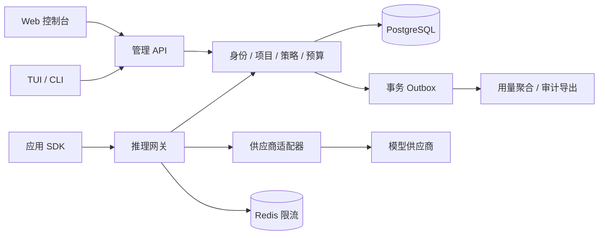

# 系统与前端架构

配套阅读：[开源架构参考与采用边界](open-source-references.md)。参考项目用于选型验证，尚未引入运行依赖。

源码研究后的细化决策见[验证报告](research/findings.md)：请求与 attempt 分开记账；预算取消后进入待核对状态；策略采用不可变发布版本；终端框架须固定兼容的大版本。

## 1. 推荐基线与理由

采用 Go 模块化单体后端、React + TypeScript Web、Go TUI。网关涉及 SSE、取消、限流与并发预算，Go 同时适合服务端和单文件终端工具；Web 使用成熟组件生态。先保持一个部署单元，通过模块和接口隔离领域，避免在需求与团队规模未知时拆微服务。

当前已采用 Go net/http ServeMux、PostgreSQL/pgx、coreos-go-oidc、Vite/React/TypeScript、React Router、TanStack Query 和 TDesign React，依赖固定版本并提交锁文件。OpenAPI 生成 Web 类型并检查差异。Redis/sqlc/TUI 仍待实现和验证，现有路由无需额外框架。具体运行方式见[管理 API](management-api.md)及[Web 控制台](web-console.md)。

## 2. 边界与请求流



后端模块：identity、organization、project、credential、catalog、policy、gateway、usage、audit。transport 仅做协议转换，application 编排用例，domain 定义规则，infrastructure 实现数据库和供应商调用。模块之间使用明确接口，不互相直接读写内部表。

管理与推理 API 分离认证、请求大小、超时、限流和日志规则。首期同进程不同路由，后续可按资源竞争和故障隔离证据拆进程。健康检查区分 liveness 与 readiness；数据库/必要缓存故障影响 readiness，单个供应商故障不让整个实例失活。

推理链路：生成 request_id → 解析并验证密钥 → 校验组织/项目/模型 → 策略判定 → 限流 → 原子预留预算 → 上游请求 → 流式/非流式响应 → 费用结算与用量落库。每一步均支持 context 取消；客户端断开时取消上游并进入结算流程。

客户端请求 context 控制转发与上游取消；结算使用独立、有时间上限的 context，并由持久化恢复任务兜底。逻辑请求与上游尝试分别使用 request_id/attempt_id；计费和预留不能依赖可在每次尝试重复执行的通用钩子。

首期不做自动跨供应商回退。只有确认未发送上游且响应未开始时才允许有限重试；禁止在 SSE 已输出后重放。设置请求体和输出上限、上游首字节与总超时，流式写入尊重背压。上游地址仅允许管理员设置，限制协议、重定向与私网目的地，防止 SSRF。

## 3. 数据、一致性与预算

核心实体：Organization、User、Membership、Project、ProjectRole、Provider、Model、ProjectKey、PolicyVersion、Budget、BudgetReservation、UsageEvent、AuditEvent。所有租户业务查询带 organization_id，项目查询同时验证项目归属；复合约束防止跨组织关联。可增加 PostgreSQL RLS 作为纵深防御，但不能替代应用授权。

供应商凭证通过部署密钥管理系统或密文存储，密钥与数据库分离。项目密钥使用高熵随机值，数据库仅存安全摘要和可展示前缀，创建时展示一次；缓存短 TTL，撤销必须能及时失效。

预算硬上限以 PostgreSQL 事务原子更新为权威：预留输入估算与输出上限对应费用，并校验已用 + 预留不超过额度。限制最大输出 token；服务端 tokenizer 与供应商计价差异必须保守处理。缺乏可靠成本上界的模型不得宣称提供严格硬限额。金额使用整数最小计价单位或定点数，禁止浮点累计。

结束后用上游 usage 结算并释放剩余预留；usage 缺失时保守计费并标记待核对，不能直接记零。结算通过 request_id 唯一约束幂等。崩溃遗留预留由恢复任务核查，无法确认上游状态时保留保守估算，而非盲目超时释放。预算账本与 outbox 在同一事务写入，聚合与导出可异步重试。Redis 故障时首期限流拒绝新请求并返回可识别错误，不无限放行。

预留状态显式区分 reserved、dispatched、uncertain、settled、released 与 estimated_final；只有确认未派发的请求可直接释放。预留绑定价格版本、币种及预算周期。策略编辑与运行分离：发布事务创建不可变版本并切换 active 指针，请求固定所使用的策略版本；紧急凭证撤销独立处理。

## 4. API 与认证契约

管理接口使用 `/api/v1`；集合分页、筛选和排序字段固定白名单。错误包含 code、message、request_id 和可选字段错误，HTTP 状态码与业务语义一致。错误不回显上游敏感数据。OpenAI 兼容端点保持对应错误及 SSE 格式，兼容范围单独写文档和契约测试。

Web 管理登录优先对接 OIDC，服务端持有会话并设置 Secure、HttpOnly、SameSite Cookie，写操作防 CSRF；不把管理 token 放入 localStorage。TUI 使用 OIDC device flow 或系统浏览器授权加 PKCE，需先验证身份提供方支持。凭证优先存系统钥匙串；无钥匙串时显式告知并使用权限受限文件，非交互流程通过受控环境注入。开发期的测试身份仅用于本地并由启动配置明确隔离，生产禁止启用。

供应商连通性测试、密钥创建/撤销、策略版本发布等敏感操作记录操作者、作用域、变更前后摘要与结果。审计写入失败不得静默忽略，关键配置变更与审计记录同事务提交。

## 5. 前端结构与状态边界

正式应用的目标目录（部分原型目录已创建，管理端/Web/TUI 尚未实现）：

```text
cmd/gateway/              服务入口
cmd/migrate/              独立数据库迁移与状态检查
cmd/aigw/                 CLI / TUI 入口
internal/<domain>/        领域模块与适配器
api/openapi/              管理 API 契约
internal/database/        版本化迁移、旧库接管与只读结构核对
web/src/App.tsx           会话入口与失效清理
web/src/features/         按项目、密钥、预算等业务组织
web/src/shared/           反馈组件、格式和资源分页 Hook
web/src/generated/        OpenAPI 生成类型
tests/integration/        数据库与供应商协议集成测试
docs/adr/                 架构决策记录
```

Web 服务端状态由 TanStack Query 管理；筛选、分页放 URL；局部表单和弹窗放组件状态。仅在跨页面客户端状态确有需要时引入额外 store。生成的 API 类型随契约构建，禁止 Web 自行复制数据库类型。运行时校验表单与不可信输入，服务端再次校验。

共享范围：Web 与 TUI 共用 OpenAPI 契约、权限定义、状态码和术语；不强行共享渲染组件。TUI 通过生成或经契约测试的 Go 客户端访问 API，不直连数据库。TUI 按 model/update/view 分离状态、命令和渲染，网络调用可取消，刷新失败保留最后数据并标记过期。

基础 UI 统一封装页面标题、资源表格、筛选栏、状态标签、确认弹窗和详情抽屉。表格采用服务端分页；危险操作展示资源和作用域并防重复提交。遵循 WCAG 2.2 AA 的键盘、焦点、对比度与可访问名称要求，使用自动扫描配合人工键盘验证。图表必须有文本数值或表格替代。

## 6. 部署与可观测性

本地采用 PostgreSQL、Redis 和可控模拟供应商；真实供应商只用于显式开启的冒烟验证，不成为常规 CI 前提。开发启动命令、容器镜像和健康探针在脚手架阶段落地并验证。

OpenTelemetry 串联管理 API、推理链路及供应商调用；指标包括请求量、错误分类、首 token 延迟、端到端延迟、token 用量、预留预算和结算积压。指标标签禁用 request_id、密钥等高基数/敏感值，request_id 只进入日志和 trace。

部署前执行独立迁移任务；采用向后兼容的 expand/contract 变更，应用回滚不依赖破坏性数据库回滚。配置启动时校验；生产密钥缺失直接拒绝启动。备份与恢复演练属于上线验收。

当前已提供[事务型版本迁移](database-migrations.md)与独立命令，正常启动/readiness 不做 DDL。结构核对覆盖已登记的受管表；生产大库、非事务 DDL 与数据库大版本升级仍需专项验收。
