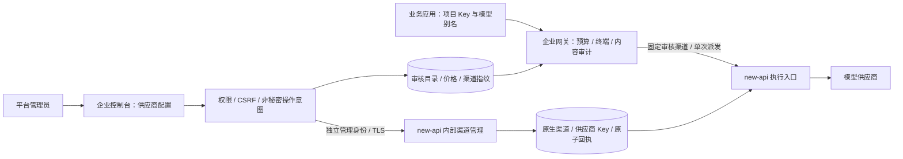

# new-api 双进程 V1 候选部署与验收

## 交付范围

2026-11-07 确认的 V1 范围是现有四类受控 API：Chat Completions（含审核客户端函数／内联图片）、文本 Embeddings、无状态文本 Responses、纯文本 Messages。后两者支持的结构化文本、实时流及明确排除项见 [交付跟踪](v1-delivery.md#当前确认的-v1-公共协议范围) 和包内 `api/openapi/management.json`。不表示完整 OpenAI／Anthropic／Claude Code 兼容。

本 Linux 包只包含企业控制面、管理 Web、CLI、迁移和主机代理工具。默认执行模式仍为 native；显式 newapi 模式需要另外部署经过审核的真实 new-api 服务。不传 --providers 时使用企业数据库中的审核目录，管理入口可配置真实渠道并审核发布；--providers 保留只读目录兼容模式。包不含 new-api 可执行文件、Web、数据库、供应商账号或测试夹具，也不会安装服务或执行迁移。Bifrost 独立入口不在这个包内。

`manifest.json` 保留格式 1 的 `engine:native` 默认值，新增 `execution_engines:["native","newapi"]` 与 `newapi` 声明。数据面源仓库、已验证的完整提交号及 `bundled:false` 同时保存在 `deploy/newapi-compatibility.json`；两份值必须一致。当前固定 934d85c3cd6f8eb0ef51514cb833ce5719cc6531，不把分支名或“最新版”当成已验证版本。验证器兼容旧版 native 包，但旧包不因此获得新协议能力。

## 部署前置条件

| 对象 | 要求 |
| --- | --- |
| 控制面 | 独立非 root 账号；专用 PostgreSQL；正式 HTTPS origin、身份模式和加密密钥；可信构建来源及整包摘要 |
| 数据面 | 真实 new-api 服务及独立持久数据库；上述已验证提交；保留原项目署名／许可证并完成实际分发授权审查 |
| 内部网络 | 只允许控制面访问治理入口，使用实际端到端 TLS；不能用转发头冒充 TLS；客户端不得直接取得内部服务令牌或绕过控制面 |
| 服务身份 | new-api 中专用服务用户及原生 sk- Token；服务用户不与管理员个人或其他控制面集群混用；监控其停用、有效期和原生额度 |
| 渠道目录 | 运维审核实际端点、凭证、模型映射、覆盖参数、驻留证据、价格／计数边界；将审核后的渠道指纹写入只读目录 |
| 外部验收 | 目标 Linux／NetworkManager、32 GiB 主机和 CPU 规格、IdP／终端、供应商真实计量与账单、代理流式传输及跨主机故障 |

不要使用 `scripts/testdata/governance_server` 作为产品数据面，它只有合成供应商与测试身份。测试二进制通过不等于真实产品安装完成。数据面的正常构建、管理初始化、备份和授权材料须按其实际项目交付流程提供；本包不会替代这些步骤。

## 配置与启用顺序

1. 保存两端数据库及密钥备份，在隔离环境验证可恢复。分别记录控制面包源 commit／SHA-256 和数据面实际 commit，不只记录分支。
2. 先准备数据面。设置 `GOVERNANCE_SERVICE_USER_ID` 为专用服务用户 ID；配置成对的 `SERVER_TLS_CERT_FILE`／`SERVER_TLS_KEY_FILE`。未配置服务用户时治理路由不注册；证书配置错误应阻止启动。原生厂商凭证只放在数据面受控存储。
3. 通过独立管理通道核对渠道配置。服务身份访问 `GET /internal/governance/v1/channels/{id}/revision` 获取指纹；它只提供指纹与状态，不替代审批。审核完成后更新模型目录的 `newapi_channel_id`／`newapi_channel_revision`、价格、输入／输出上限和驻留证据。禁止自动把最新指纹当成审批。
4. 控制面通过服务管理器／秘密系统注入 `AIGW_NEWAPI_ORIGIN` 和 `AIGW_NEWAPI_SERVICE_TOKEN`，同时注入数据库、身份和审计密钥。网关不会自动加载 `.env`。目录不含供应商密钥。
5. 显式启动控制面，以下路径由部署方替换为实际受控路径：

```sh
/opt/aigw/current/bin/aigw-gateway \
  --execution-engine=newapi \
  --web-dir=/opt/aigw/current/web \
  --listen=127.0.0.1:8080
```

6. 默认启动会事务加锁自动升级控制面到 schema v31，校验和、漂移、新版本拒绝与失败回滚继续生效。分离迁移账号可先 `aigw-migrate up`／`check`，业务进程再用 `--schema-mode=check`。自动升级不等于自动备份、混合版本无停机升级或自动降级。
7. 检查 readiness。它包含恢复能力协商与审核指纹，失败时不开放新推理；不能通过绕过 readiness 掩盖错误。确认恢复扫描、预算和审计指标正常后再逐项执行验收。

`GOVERNANCE_ALLOW_LOOPBACK_HTTP` 和 `AIGW_NEWAPI_ALLOW_LOOPBACK_HTTP` 仅为明确启用的本机测试选项；正式部署使用可信证书和实际 TLS，不据此部署跨主机明文链路。主机网络写操作另按 [系统管理](system-management.md) 验收，不由本部署流程自动启用。

## 四类接口验收记录

每项记录源提交、模型／渠道审批依据、测试身份、脱敏请求 ID、实际物理调用数、预算前后值、原始用量、回执及内容审计状态。真实调用先确定费用预算，使用合成文本，不将秘密或真实业务正文写入验收报告。

| 场景 | 验收要点 |
| --- | --- |
| Chat | JSON／SSE；审核函数参数和调用关联；审核内联图片；未审核内容拒绝；完整工具结果须等待完成证明 |
| Embeddings | 文本批量／float 维度边界；input-only 费用；向量不冒充可文本审计的输出；未支持编码拒绝 |
| Responses | 字符串与文本消息列表；store=false；JSON／实时 SSE；跨块关键词；缺失完成证明不发 completed |
| Messages | 字符串／text 块和 system；审核 Anthropic 实时流；起始计数为原始临时证据；最终 message_stop 需结算与审计封存 |
| 公共治理 | 跨租户／撤销 Key／设备证明拒绝；预算不足不派发；输入拦截和输出策略；正文查看授权、加密、保留与封存 |
| 细分计费 | 普通输入、缓存读、缓存写、可选 5 分钟／1 小时费率；每项原始计数与真实账单对应；缺失细项不猜零 |
| 故障 | 客户端取消、断流、缺失 trailer、审计拒绝、控制面／数据面退出；未知费用保留占额；原始完成事件幂等恢复，不自动重试 |
| 容量 | 20 路实际供应商并发，逐笔账本／回执／审计守恒；目标 32 GiB、长流／持续负载／内存及跨主机网络独立验收 |

已有本机 4 vCPU／16 GiB、合成供应商、真实隔离数据库、SDK、浏览器、双控制面 SIGKILL 和 20 并发开发证据见 [集成记录](new-api-integration.md) 与 [性能基线](new-api-performance.md)。不能据此勾选真实账号、目标硬件或生产 SLA。

## 升级与发布边界

先核对数据面能力和完整版本，再审核渠道指纹，最后升级控制面；启用细分时长计费前必须退出不识别新回执的旧消费者。保持同一专用服务用户进行 Token 轮换。已在途请求使用绑定的历史配置／价格，事后改价不能改变它的结算。

普通回滚只能在兼容范围内更换版本，不能让旧二进制直接连接较新结构。数据库恢复不会撤销供应商已产生的费用，也不会恢复外部网卡状态；必须补齐备份后的撤销与账务事件。正式切流前完成真实供应商／账单、IdP／终端、目标硬件／NetworkManager、跨主机故障、密钥恢复和实际分发授权审查。此包为 development_candidate，不生成 V1.0 标签或自动切换生产流量。

## 统一供应商渠道管理



供应商 Key 由平台管理员配置一次；业务用户仅使用企业项目 Key，无需填写或接触供应商 Key。渠道及其凭据以 new-api 为权威来源，企业侧保存审核关系、价格和变更结果。预算、项目授权和审计始终在企业网关入口执行。

企业控制台“供应商配置”在 newapi 模式下显示“供应商渠道”和“发布真实路由与价格”。本阶段支持 OpenAI 兼容（1）、DeepSeek（43）、Anthropic（14）渠道的名称、Base URL、上游模型、启停及凭证替换。多 Key 可整体替换为轮询列表；不展示原密钥，不支持读取密钥、删除渠道、导入账号 Cookie、任意协议插件或高级参数透传。其他类型及存在隐藏协议覆盖的渠道可查看，不可在此编辑，既有高级配置不会被清空。

部署需增加两端参数：

- new-api：`GOVERNANCE_CHANNEL_ADMIN_USER_ID` 指定第二个独立服务用户，必须与 `GOVERNANCE_SERVICE_USER_ID` 不同。使用普通专用用户即可，不要复用个人管理员。其原生 sk- Token 要保持有效、未撤销、账号启用，并配置足够额度或专用非消费管理 Token 的无限额度；该身份的 Token 不能调用推理入口。
- 企业控制面：`AIGW_NEWAPI_ADMIN_TOKEN` 保存该服务用户的令牌；`AIGW_PROVIDER_ADMIN_ISSUER` / `AIGW_PROVIDER_ADMIN_SUBJECT` 指定唯一有权操作的平台身份。此身份与组织 owner/admin 分开授权。执行与管理令牌不能相同。
- new-api：`GOVERNANCE_CHANNEL_ALLOWED_ORIGINS` 用逗号分隔明确批准的供应商 origin（协议、主机、端口）。默认允许三个对应官方 API origin；其他企业批准的兼容服务必须显式加入。生产只接受 HTTPS，无 URL 用户信息、query 或 fragment；本机 HTTP 只用于显式测试。页面保存不探测端点，出口与 DNS 控制仍由部署层负责。
- 内部管理接口路径为 `/internal/governance-admin/v1/`，只允许企业后端访问；浏览器只请求同源 `/api/v1/newapi/`，不取得后台服务 Token。保留已有实际 TLS、网络隔离、CSRF、平台身份绑定、原生令牌过期/撤销和账号状态校验。不要记录写入请求正文。

操作顺序：先创建或编辑渠道，再核对端点、账号、模型和价格；选择渠道形成审核指纹，填写模型别名、价格与驻留依据，确认审核后发布目录。支持 Chat/文本 Embeddings、缓存计费、审核工具/图片与 Anthropic Messages 流的相应配置，服务端仍逐协议拒绝越界组合。文件模式下只能管理渠道，不能发布数据库目录；切换到数据库模式须在维护窗口通过管理入口重新审核录入原目录，不自动导入或批准。

目录保存到新迁移 0031 的版本化表并与操作记录原子提交。各实例约每 5 秒启动一轮原生能力与渠道指纹校验；依赖延迟或失败会推迟生效，未完成验证时不接受该目录的新推理。共用一个执行器、并发限制与恢复工作线程，在途请求保留旧 Route，不产生双执行或静默回退。更改正在使用的渠道会使旧目录失效；建议新建替代渠道→审核切换目录→排空旧请求→停用旧渠道。当前仍有整体 readiness 的影响范围，尚未实现逐渠道故障隔离。

渠道写入先保存企业侧非秘密操作意图，再请求数据面；数据面将渠道、原生能力表和审计回执放在同一事务中，以操作 ID 去重。页面展示“已保存 / 被拒绝 / 结果待核查”。待核查不得当作未保存；先点“查询保存回执”，它只恢复已有回执，不重放凭证或重新创建渠道。控制面不持久化供应商密钥。原生凭据仍遵循 new-api 本身的存储方式，本功能不声称已给原生渠道表增加透明加密或 KMS。

无法读取远端回执时操作保持 pending。近期操作界面固定显示最新 50 条，历史数据库记录不删除；尚无后台自动重放写操作。控制面账务恢复与渠道管理回执是不同流程。数据面原生 Token 校验仍包括额度条件，应监控后台服务令牌额度与有效期。

安全设计参考 OWASP ASVS 5.0.0 的认证、会话、授权、通信与日志控制域，以及 [Authentication](https://cheatsheetseries.owasp.org/cheatsheets/Authentication_Cheat_Sheet.html)、[Session Management](https://cheatsheetseries.owasp.org/cheatsheets/Session_Management_Cheat_Sheet.html)、[REST Security](https://cheatsheetseries.owasp.org/cheatsheets/REST_Security_Cheat_Sheet.html)。本阶段覆盖服务端权限与凭据隔离、TLS、目标地址白名单、CSRF、撤销、非秘密审计、CAS 和失败恢复测试；不代表完整 ASVS 认证，外部 IdP 的 MFA/敏感操作再认证与真实网络部署仍须独立验收。
