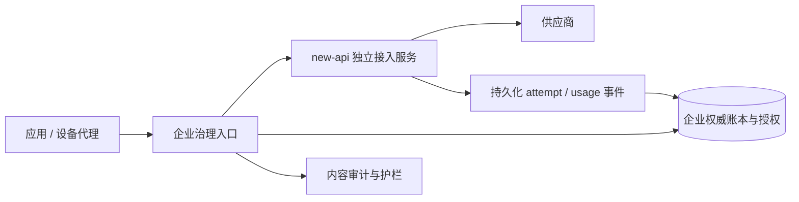

# new-api 底座重新评估

日期：2026-11-07。检查对象为本地 `/workspace/new-api`，远端 `jhzhfree/new-api`，commit `e03439033238722c0b8d4437a052445f3aeeed83`（2026-11-06）；当前产品参考基线为 `ai-governance-gateway` 的 `940a68f`。本轮是只读静态抽样与官方授权/发布信息核对，没有修改 new-api，没有运行其测试、压测或真实供应商调用。因此不能据此认定生产就绪或不存在安全缺陷。

## 结论

new-api 值得作为本产品模型接入底座的优先验证对象。它的协议/渠道覆盖、Token 运营和计费产品能力明显比当前四厂商文本执行层更广，继续逐个复制这些能力会扩大自研维护面。但“直接套 UI 就是企业网关”和“前后两层串联即可复用全部治理”都不成立。

推荐：先通过授权门禁和计费/审计集成原型，再采用“现有企业控制面 + 独立 new-api 接入服务”的形态，保留将来迁移为产品化 fork 的选择。暂不删除原生执行器/Bifrost，也不继续扩展三套重复执行能力。协议转换、渠道维护交给选定底座；企业权威账本、身份、终端和审计只设一个明确所有者。

## 1. 实际代码证据

以下链接固定到本次检查的 fork commit，不将上游最新版本行为自动归于当前 checkout。

| 观察 | 代码依据 | 对本产品的影响 |
| --- | --- | --- |
| Token 包含期限、额度、模型限制、IP、分组、跨组重试；Key 为持久字段，GetFullKey 返回该值、Insert 直接 GORM Create | [model/token.go L14–36、80–85、284–311](https://github.com/jhzhfree/new-api/blob/e03439033238722c0b8d4437a052445f3aeeed83/model/token.go#L14) | 功能较完整；不能继承为“仅摘要存储、明文绝不恢复”的保证。需核查所有读出/缓存/加密与管理展示路径，决定是否改为摘要模型 |
| BillingSession 管理预扣、结算、退款；资金来源与 Token 额度分步提交，进程内标志防重复退款 | [service/billing_session.go L26–90](https://github.com/jhzhfree/new-api/blob/e03439033238722c0b8d4437a052445f3aeeed83/service/billing_session.go#L26) | 是明确生命周期设计，不是完全没有计费抽象；但不能直接等同当前 PostgreSQL 企业双层账本事务与崩溃恢复语义 |
| 部分缺失 usage 分支会使用估计输入 token，并置输出为 0 | [service/text_quota.go L248–256](https://github.com/jhzhfree/new-api/blob/e03439033238722c0b8d4437a052445f3aeeed83/service/text_quota.go#L248) | 必须传递用量来源与完整性；不能把估计值包装成供应商最终用量。不能据此推断所有协议都执行相同回退 |
| 控制器包含选渠道、计费准备和按 RetryTimes 的内部重试循环 | [controller/relay.go L160–238](https://github.com/jhzhfree/new-api/blob/e03439033238722c0b8d4437a052445f3aeeed83/controller/relay.go#L160) | 前层一次调用可能对应多次物理尝试；不得再盲目叠加控制面重试 |
| Chat 之外可见 Claude Messages、Responses/WebSocket、Realtime、Embeddings、音频等路由；部分接口明确未实现 | [router/relay-router.go L78–169](https://github.com/jhzhfree/new-api/blob/e03439033238722c0b8d4437a052445f3aeeed83/router/relay-router.go#L78) | 覆盖范围远大于当前文本子集；必须逐协议建立治理验收，不能以兼容名称推断全量支持 |
| 已有 Casbin 授权模块，策略为 sub/obj/act/eft | [service/authz/enforcer.go L20–35](https://github.com/jhzhfree/new-api/blob/e03439033238722c0b8d4437a052445f3aeeed83/service/authz/enforcer.go#L20) | 不能简单称它“没有 RBAC”；但检查的主数据/路径仍以用户、渠道、分组为主，没有证明与当前组织/项目/部门预算和授权等价 |
| 日志包含用户、Token、模型、渠道、用量、Quota、请求与上游请求 ID、扩展字段 | [model/log.go L57–79](https://github.com/jhzhfree/new-api/blob/e03439033238722c0b8d4437a052445f3aeeed83/model/log.go#L57) | 可复用运营统计基础；Content 字段不能单凭名称认定是完整请求/回复正文，更不能等同加密正文审计 |
| 主库/日志库使用 AutoMigrate；仓库要求三数据库兼容 | [model/main.go L342 起](https://github.com/jhzhfree/new-api/blob/e03439033238722c0b8d4437a052445f3aeeed83/model/main.go#L342)、[AGENTS](https://github.com/jhzhfree/new-api/blob/e03439033238722c0b8d4437a052445f3aeeed83/AGENTS.md) | 对产品 fork 的数据库变更要考虑升级矩阵；不要与现有 0025 迁移链共用表或互相执行迁移 |

文件盘点：36 个 `relay/channel/**/adaptor.go`、307 个 `*_test.go`。这只是文件计数，不是厂商可用数量、测试通过数量或覆盖率。root、relaykit、tokenkit 有独立模块边界；新增协议仍可能涉及宿主路由、计费、转换与日志多个层次。

## 2. 与需求契合度

| 需求 | new-api 可复用部分 | 需要保留/新增 |
| --- | --- | --- |
| Token | 生命周期、额度、模型/IP/分组约束、管理页面 | 企业项目归属、审批/密钥保管要求、跨实例撤销证明、仅摘要存储方案 |
| 费用治理 | 钱包/订阅资金来源、预扣结算、价格/用量处理、运营日志 | 组织+项目预算硬限额、部门归集、双人调额、uncertain 与账单核验；先选唯一权威账本 |
| 统计分析 | 用户/渠道/模型/用量/费用元数据基础 | 企业组织口径、历史价格/部门快照、供应商成本与内部分摊分离 |
| 身份 | 已有登录/OAuth/OIDC 等集成及 Casbin 授权基础 | 企业目录映射、职责分离、离职回收；本地账号不代表能作为完整 OIDC Provider |
| 终端控制 | Token/IP/流量限制可作为补充 | DPoP、设备状态、会话绑定、撤销、终端代理和出口防绕过 |
| 内容审计/护栏 | 请求转发与响应处理是扩展点，已有运营/操作日志 | 标准化事件、密文保存、独立解密权限、留痕/保留策略；工具/多模态按内容类型处理 |
| 性能扩展 | Redis/缓存、多数据库、渠道调度和协议覆盖 | 真实目标负载实测，双层代理成本，队列/事件反压和故障恢复；不凭宣传指标承诺 QPS |
| 主机管理 | 不作为本次主要复用对象 | 保留独立系统管理代理与权限边界，不合入 new-api root 进程 |

## 3. 代码设计与成熟度判断

优点：协议与运营场景积累广；计费生命周期、资金来源、转换/token 模块已有抽象；存在针对计费溢出、重试、协议转换及授权的测试和编码规则。这比从零重写所有供应商转换更有复用价值。

代价：root 的 Gin context、全局设置、GORM、渠道/用户模型和计费逻辑存在耦合；改成纯执行器并非替换一个接口。多数据库兼容增加约束与测试面。任务插件、媒体协议、重试、缓存以及复杂计费扩大安全与维护范围。规范存在不能证明每条规范都已落实。

官方发布页当前列出 v1.0.0-rc.48（2026-11-04），仍属于 RC 命名，且发布说明包含缓存与流式计费修复。说明项目活跃，也说明需要版本锁定与升级回归；不是自动的稳定性保证。此次未对本地 fork 与该 release 做完整差异分析，不能把 fork 当作 release 本身。[官方发布页](https://github.com/QuantumNous/new-api/releases)

本轮身份部分只做架构抽样，不是安全审计。后续应按 OWASP ASVS 5.0.0 对身份绑定、会话撤销、CSRF、凭证保存和权限隔离逐项验证；未验证不记为通过。[ASVS](https://asvs.owasp.org/)

## 4. 授权与商业交付门禁

检出的 LICENSE 为 AGPLv3，NOTICE 还有作者署名和显著位置原项目链接等要求。[固定 LICENSE](https://github.com/jhzhfree/new-api/blob/e03439033238722c0b8d4437a052445f3aeeed83/LICENSE)、[固定 NOTICE](https://github.com/jhzhfree/new-api/blob/e03439033238722c0b8d4437a052445f3aeeed83/NOTICE)。

AGPL 不等于禁止收费或商业使用；但商业使用也不意味着可以任意闭源改造、去署名后分发。分发、修改后向用户提供网络服务的源码义务需要按 LICENSE（包括第 13 条）与实际交付形式落实。独立进程或 HTTP 接口不自动形成“完全不受影响”的法律结论。

官方 README 提供不接受 AGPL 义务时联系商业授权的途径，但这不是已经获得授权，也不能推断价格、覆盖范围或可再分发权。[官方授权说明](https://github.com/QuantumNous/new-api#-license)

决策：接受 AGPL 合规交付，或取得覆盖修改、交付、前端署名处理、关联组件与升级版本的书面商业许可。由法律顾问确认方案。若目标必须闭源且授权尚未落实，不应进入深度 fork；授权核验是本项目真实前置事项，不是泛化免责声明。

## 5. 推荐接入架构

- 外部只暴露企业入口。new-api 服务与管理端进入受控内网，使用服务身份/网络限制；普通用户不能直接访问并绕过准入、预算或审计。
- 保留企业 Token 或显式迁移到 new-api Token，二选一做真实外部鉴权；内部凭证按最小权限映射，不能用可外泄的无限额度 root Key 代替设计。
- 企业层拥有组织预算权威；new-api 的计费应成为可核对的执行用量/供应商成本，而不是另一套可独立改变企业余额的账本。不要靠“余额设得很大”宣称关闭第二账本。
- 需要开发适配契约，传递业务 request_id、物理 attempt_id、渠道/模型、价格版本、用量来源、完成性、缓存/思考/工具等分项、终止原因。标准兼容响应通常不足以携带这些事实。
- new-api 内部重试首期关闭或受控单次；验证每次物理尝试后再开放。不允许在前层响应失败时自动重试整次调用。
- 事件需要持久 outbox、幂等消费、重放/对账和积压告警；控制面失败后不能丢失已产生费用的事实。这是建议新增契约，不是已确认现成扩展能力。
- 前置层可观察客户端请求/最终输出，但看不到所有上游转换、重试和内部任务状态；正文审计要明确“用户视图”与“上游物理请求”的取证范围。
- 两个服务分开数据库/schema、迁移链与发布生命周期。平台前端逐页复用能力，不做两套后台互相可写同一业务资源。

## 6. 取舍与实施门禁

| 方案 | 收益 | 代价/结论 |
| --- | --- | --- |
| 深度 fork new-api 成统一产品 | 快速复用完整渠道与运营 UI | 授权、租户/账本改造及长期合并成本最大；先过许可与原型，不直接推翻现有代码 |
| 企业控制面 + 独立 new-api | 保留已投入治理、扩大协议覆盖，减少 root 包源码耦合 | 不是零改造；计费/事件、双层开销、权限防绕过必须验证。优先试验 |
| 继续全部原生自研 | 规则一致性最可控 | 厂商与协议维护成本持续增长，不宜以此追赶 new-api 全量能力 |

建议原型先覆盖两类最关键的实际模型路径，至少一条有缓存用量的 SSE；同时验证 Responses/工具类协议的审计边界。新增协议在治理链尚不能正确解析时仍拒绝，不因后端支持就直接开放。

必过用例：Token 撤销与跨租户越权、直接访问后端的拒绝、预算并发耗尽、首字节前/后断流、缺失或冲突 usage、重复终态事件、两层进程 SIGKILL、数据库/事件链故障、渠道内部重试、审批/对账、版本升级回退与权限/密钥恢复。每个用例记录实际物理调用次数、持久费用与客户看到的结果。

工作量仅作排期假设：熟悉 Go/PostgreSQL/React 的 2–3 名工程师，针对独立服务接入的技术原型约 2–3 周；若原型通过，受限文本产品化及故障门禁再约 4–8 周。完整工具/多模态/异步任务治理、商业许可等待和真实外部验收另计，不能把该估计当成 V1 全量承诺。深度 fork 的排期应在差异设计后重估，不用现有页面数量推算工期。

当前行动建议：保留现有工程；冻结扩大自研厂商适配；先完成许可确认与最小适配实验，再用可复现证据决定是否迁移。此次没有切换执行器、同步真实密钥或修改生产配置。
