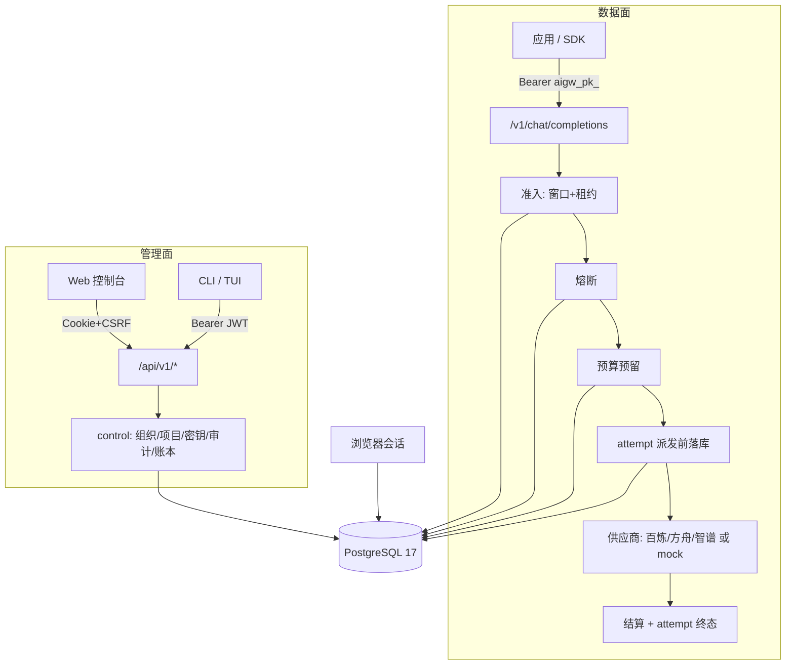
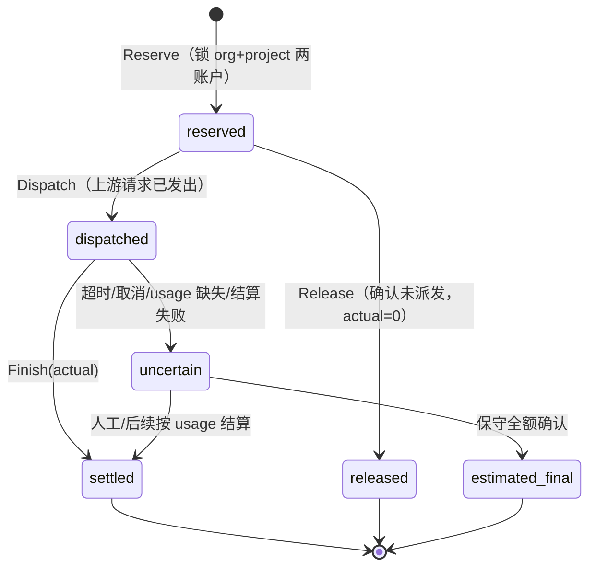
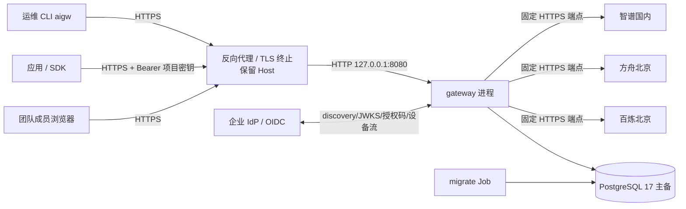

# 序衡 · AI 治理网关 — 全局产品说明（开发与发布基线）

| 项目 | 内容 |
| --- | --- |
| 产品名 | 序衡（AI GOVERNANCE）；技术名 `ai-governance-gateway` |
| 代码基线 | `main` @ `92047a2`（2026-11-04，feat: isolate supplier failures with shared circuits and runtime status） |
| 文档性质 | 面向研发、运维、产品与发布的全局说明；不是营销材料，也不替代各专题文档 |
| 分析方式 | 静态阅读源码 + 迁移 + 测试脚本 + 现有文档。分析环境无 Go/Node/Docker，未重新执行 `scripts/verify.sh`；文中测试数字均标注来源为仓库记录 |
| 维护规则 | 架构边界、发布门禁变化必须更新本文；专题细节仍以 `docs/` 下对应文档和 ADR 为准 |

> 阅读顺序建议：第 0、1 节建立产品认知 → 第 2、3 节理解实现 → 第 4 节作为编码约束 → 第 5、6 节决定能否发布 → 第 7、8 节安排下一步工作。

---

## 0. 一页速览

**是什么**：面向企业内部团队的大模型统一接入与治理平台。它在团队应用与模型供应商之间提供一把"带账本的钥匙"：统一入口、项目级密钥、模型白名单、限流与并发控制、预算硬限额、调用账本、执行结果与审计。

**核心能力（当前代码状态）**

| 能力 | 状态 | 说明 |
| --- | --- | --- |
| OpenAI 兼容推理入口（`/v1/chat/completions`） | ⚠️ 已实现 | 文本 JSON / SSE；仅单 choice；不支持 tools、多模态、n>1 |
| 项目密钥 + 模型白名单 + 实时撤销 | ✅ 已实现 | `aigw_pk_` 前缀，库内仅存 SHA-256 摘要，创建时一次性展示 |
| 预算硬限额（预留→结算） | ✅ 已实现 | PostgreSQL 事务 + `request_id` 幂等；金额整数最小单位 |
| 项目限流与并发租约 | ✅ 已实现 | 60 秒滑动窗口 + 并发租约，默认 60 rpm / 4 并发 |
| 供应商共享熔断 | ✅ 已实现 | 5 次失败 open，30 秒冷却，半开单探测，generation 隔离 |
| 执行 attempt 元数据 | ✅ 已实现 | 派发前落库，终态不可覆盖，与结算解耦 |
| Web 控制台（OIDC 会话） | ⚠️ 已实现 | 组织/项目、预算、密钥、模型授权、记录、限流、核查、运行状态 |
| CLI / TUI（只读） | ⚠️ 已实现 | Device Flow 登录；无任何写操作 |
| 三家大陆供应商适配 | ⚠️ 代码完成，未真实验收 | 百炼北京、方舟北京、智谱国内；人民币 `CNY_MICRO` |
| 生产部署（镜像、编排、TLS、监控） | ❌ 缺失 | 仓库内无 Dockerfile / compose / k8s / 指标导出 |

**发布结论（必须明确）**：当前版本可作为**内网试用 / 联调版本**，**不可直接作为生产计费与合规网关上线**。阻塞项集中在四类：真实企业 IdP、真实供应商与驻留证据、生产部署与可观测性、预算周期与运维能力缺口（见第 6.6、7 节）。

**一句话架构**：Go 模块化单体 + PostgreSQL 作为唯一权威状态（预算、限流、熔断、会话、执行元数据），管理面与推理面同进程不同路由；React 控制台与 Go TUI 共用同一份 OpenAPI 契约。

---

## 1. 产品定义与用户

### 1.1 要解决的问题

1. **接入分散**：每个团队各自申请供应商账号、各自保存密钥，无法统一升级模型与端点。
2. **凭证失控**：长期密钥散落在代码、CI、聊天记录中，撤销困难、无法追溯。
3. **费用不可控**：没有项目级硬额度，费用只能在月底账单里"事后发现"。
4. **故障与合规不可查**：调用失败无法用一个 ID 串联"谁、哪个项目、哪个模型、哪次尝试、是否已计费"。

### 1.2 用户与成功标准

| 角色 | 主要任务 | 成功标准 |
| --- | --- | --- |
| 组织 Owner / Admin | 建组织、建项目、配成员、授权模型、管预算 | 凭证不回显、权限变更可审计 |
| 项目负责人 | 分配项目角色、创建/撤销密钥、查看项目用量 | 项目用量与额度独立可见 |
| 应用开发者 | 拿密钥、按别名选模型、调试请求 | 15 分钟内完成首次成功调用 |
| 运维 / 审计 | 定位失败调用、核查占额、查看熔断 | 用 `request_id` 串起账本、attempt、审计 |

### 1.3 最短业务闭环（产品主路径）


产品设计明确要求首次引导围绕这条路径，不要求用户先理解内部模块。

### 1.4 明确的非目标（首期）

Agent 编排、知识库、插件市场、提示词优化、复杂结算与发票、跨区域多活、自动跨供应商回退、移动端/桌面壳。费用是**治理估算**，不等同供应商账单。

### 1.5 产品命名的现状

Web 端品牌为"序衡"，Go 模块、二进制、环境变量前缀仍为 `aigw` / `AIGW_`。对外发布前需统一命名与商标、域名、包名策略，避免文档与产物混用两套称呼。

---

## 2. 技术架构

### 2.1 形态与选型

**模块化单体**：一个部署单元承载管理 API、推理网关、控制台静态资源；模块间通过接口隔离，不拆微服务。理由是网关链路涉及 SSE、取消、并发预算，跨进程会放大一致性成本；团队规模与流量尚未给出拆分证据。

| 层次 | 选型（固定版本） | 取舍 |
| --- | --- | --- |
| 语言 / 运行时 | Go 1.26（模块声明），工具链 1.27.3（`.go-version`） | 单二进制、SSE/取消/并发友好 |
| HTTP | 标准库 `net/http` + `ServeMux` 方法路由 | 无框架依赖；路由与中间件需自建 |
| 数据库 | PostgreSQL 17 + `pgx/v5` 连接池，手写 SQL | 事务与约束作为一致性权威；无 ORM、无 sqlc |
| 身份 | `coreos/go-oidc` v3，仅 RS256 | 不做密码体系、不做 opaque token |
| Web | React 19.3 + TypeScript 5.9 + Vite 8 + TDesign 1.18 + TanStack Query 5 + React Router 7 | 服务端状态交给 Query；无 Redux 类全局 store |
| TUI / CLI | Cobra 1.10 + Bubble Tea v2.1.1 + Lip Gloss v2.0.6 | 只读客户端，复用 HTTP API |
| 契约 | OpenAPI 3.0.3 → `oapi-codegen`（Go）/ `openapi-typescript`（TS） | 生成物入库并做漂移检查 |

**尚未引入且不应假设存在**：Redis、sqlc、OpenTelemetry SDK、Prometheus client、消息队列、ORM、服务网格。

### 2.2 代码结构地图

```text
cmd/gateway/         进程入口：配置校验、依赖装配、路由、健康检查、优雅退出
cmd/migrate/         独立迁移/状态/检查命令（不依赖 OIDC、供应商、Web）
cmd/aigw/            CLI/TUI 入口
cmd/mock-provider/   仅 loopback 的确定性 OpenAI 风格模拟上游
internal/gateway/    推理链路：解析、授权、准入、熔断、预算、派发、SSE、结算
internal/provider/   不可变模型/价格/区域目录与协议适配
internal/budget/     预算账户、预留状态机、outbox 写入、恢复
internal/admission/  项目限流（滑动窗口）与并发租约
internal/circuit/    供应商共享熔断
internal/execution/  attempt 元数据（派发前写入、终态不可覆盖）
internal/control/    组织、项目、成员、密钥、审计、账本查询
internal/httpapi/    管理 API 传输层（鉴权、CSRF、分页、错误映射）
internal/identity/   OIDC JWT 校验
internal/browser/    授权码 + PKCE 会话、Cookie、CSRF
internal/terminal/   设备流登录、只读 API 客户端、TUI
internal/database/   内嵌迁移、结构核对、旧库接管
internal/observe/    进程内 HTTP 计数（非持久化、非导出）
internal/console/    仅托管构建后的 `index.html` 与 `/assets/*`
api/openapi/         管理契约（单一事实源）
web/src/features/    按业务组织的页面（workspace/keys/models/requests/operations/audit）
docs/adr/            9 份架构决策记录
```

### 2.3 部署单元与进程

共 **4 个可执行产物**：

| 产物 | 作用 | 是否面向公网 |
| --- | --- | --- |
| `cmd/gateway` | 管理 API + 推理网关 + 控制台静态资源 + 健康检查 | 只监听 loopback，必须由反向代理暴露 |
| `cmd/migrate` | `up / status / check`，独立部署步骤执行 | 否 |
| `cmd/aigw` | 运维与开发者的只读 CLI/TUI | 否（出站访问网关） |
| `cmd/mock-provider` | 本地联调模拟上游 | 否（loopback） |

静态站点与 API 同源托管：`console.New` 只放行 `/` 与 `/assets/*`，无 SPA 深层路径回退，因此**控制台必须部署在根路径**，不能挂在 `/console/` 子路径（API 客户端也按 origin 根路径拼接）。

### 2.4 双平面：管理面与推理面



两面**认证方式完全隔离**：管理 JWT 不能调推理接口，项目密钥不能调管理接口；项目密钥也绝不透传给上游。

| 维度 | 管理面 `/api/v1` | 推理面 `/v1` |
| --- | --- | --- |
| 认证 | OIDC RS256 JWT（scope `aigw:manage`）或浏览器 Cookie+CSRF | 项目密钥 `aigw_pk_*` |
| 授权 | 组织角色 + 项目角色（服务端判定） | 密钥绑定的组织/项目 + 模型白名单 |
| 限流 | 无内置（依赖代理/网关层） | 项目滑动窗口 + 并发租约 + 熔断 |
| 计费 | 只读查询 | 预留 → 结算，写账本 |
| 超时 | 服务端读头 3s / 读 10s / 空闲 30s；出站 OIDC 6s | 上游 120s；SSE 写 2s；取消后清理 3s |
| 请求上限 | 64 KiB（JSON 严格解析） | 64 KiB，64 条消息，每条 16 KiB |

### 2.5 数据架构

**17 张业务表 + 1 张迁移台账**，全部结构变更经内嵌 SQL 迁移管理。

| 域 | 表 | 关键约束 |
| --- | --- | --- |
| 预算 | `budget_accounts` | 主键 `(org, project, period, currency)`；`project_id=''` 表示组织账户；CHECK 保证 `spent + held <= limit` |
| 预算 | `budget_reservations` | 主键即 `request_id`（幂等键）；state 六值；CHECK 绑定 state 与 actual |
| 预算 | `budget_outbox` | `UNIQUE(request_id, event_type)`；仅写入，**无消费者** |
| 治理 | `organizations` / `organization_members` | 币种 `MOCK` 或 `CNY_MICRO`，创建后不可改；角色 owner/admin/developer/viewer |
| 治理 | `projects` / `project_members` / `project_models` | 项目成员外键级联组织成员；模型白名单为行级记录（`model` 1–128 字符，0006 放宽以容纳别名） |
| 治理 | `project_keys` | `digest bytea UNIQUE`（SHA-256 32 字节）、`models text[]` 非空、`expires_at`、`revoked_at`、作用域索引 |
| 治理 | `audit_events` | 组织作用域索引；记录 actor/action/resource/time，**无字段级 diff** |
| 会话 | `browser_login_flows` / `browser_sessions` | state 摘要为主键，PKCE verifier、nonce、过期索引；会话仅存凭证摘要 |
| 执行 | `inference_attempts` | `request_id UNIQUE`（一请求一次尝试）；`completed` 必须有 `upstream_status=200` 与输入 token；跨表子查询要求预算已 `settled` |
| 准入 | `project_limits` / `admission_events` / `admission_leases` | 策略 `revision` 乐观并发；事件按窗口索引；租约 `request_id` 唯一 |
| 熔断 | `supplier_circuits` | 主键 `route_key`（价格指纹）；`failures 0..5`；非 closed 必须有 `retry_at` |

**迁移治理**：已发布 SQL 不可改，只能追加编号；整批迁移在单事务内执行并用事务级 advisory lock 串行化；`status/check/up` 独立于业务依赖；正常启动只做只读结构核对，绝不隐式建表；结构漂移、校验和不符、版本过新都会拒绝就绪。

### 2.6 一致性模型（最重要的架构约定）

1. **PostgreSQL 是唯一权威**：预算、限流、熔断、会话全部落库，进程内存不承担正确性。
2. **预留与结算分离**：先按保守上界占用，再按上游 usage 结算；不确定时保留占额（`uncertain`），绝不无条件退款。
3. **执行与财务解耦**：attempt 与预算各自独立事务；结算成功而元数据失败、或反之，都不互相回滚，只能分别对账。代码只提供"不一致时记录错误码"的能力。
4. **宁可拒绝，不可放过**：数据库故障、准入表缺失、熔断表异常 → 503 拒绝新请求（fail-closed），不做限流降级放行。
5. **不做隐式重试/回退**：一次逻辑请求只有一次上游尝试；SSE 已输出后禁止重放；失败即失败，由客户端决定是否重提。
6. **金额只用整数**：`int64` 最小单位；`CNY_MICRO` 为 1 元 = 1,000,000；管理 API 限制在 JS 安全整数内。

### 2.7 架构取舍与已知债务

| 决策 | 收益 | 代价 / 债务 |
| --- | --- | --- |
| 预算放 PostgreSQL 事务 | 多实例并发下可证明不超额 | 每次请求多次 DB 往返；高 QPS 下成为瓶颈 |
| 只用上游 usage 结算 | 不伪造 token | usage 缺失即 uncertain，人工核查成本高 |
| 按输入上界预留 | 不会低估成本 | 短请求长期占用大量额度，需要运营解释 |
| 熔断/限流也放 PostgreSQL | 多实例共享、无 Redis 依赖 | 依赖数据库可用性；每请求额外事务 |
| 单次尝试、无回退 | 语义干净、可审计 | 供应商抖动直接暴露给调用方 |
| 迁移不可回滚（无 down） | 结构历史可证明 | 回滚只能靠向后兼容的 expand/contract + 前滚 |
| 控制台无 SPA 路由回退 | 静态服务面极小、安全 | 不能深链接到子页面，只能靠 query 参数 |
| outbox 只写不投递 | 为后续异步留钩子 | 目前不产生任何异步收益，不能当作已具备 |

---

## 3. 实现原理（关键机制）

### 3.1 推理请求全链路

`internal/gateway/handler.go` 的实际顺序（严格，不可重排）：

```text
路径/方法/配置校验
→ 必须恰好 1 个 Authorization 头 → Bearer 解析
→ 严格 JSON（64 KiB、DisallowUnknownFields、拒绝尾随数据）
→ 模型别名解析（provider 目录 Find）+ 请求字段/上限校验
→ 目录 Ready()（驻留证据过期 → 503 residency_review_required）
→ 计算费用上界 Bound(max_tokens)
→ 密钥授权（401/403/503）+ 组织币种匹配
→ 观测包装 → 准入（窗口/租约）
→ 熔断（Acquire）
→ 预算预留（Reserve）
→ attempt 开始记录（Begin）
→ 派发上游（Dispatch）
→ 流式/非流式转发
→ 结算（Finish）
→ attempt 终态（Finish）
```

**SSE 处理**：`Scanner` 按事件聚合 `data:` 行，单事件上限 64 KiB，整条流上限 16 MiB；要求恰好一次 usage、必须在 `finish_reason` 之后；`[DONE]` 前未拿到 usage 即 `upstream_stream_incomplete`；EOF 不补 `[DONE]`；只有本地结算持久化后才向客户端输出 `[DONE]`。

**取消传播**：客户端 `r.Context` 直接传入上游请求；取消后熔断记中性、trace 记 `canceled/client_canceled`，预算用独立 3 秒后台 context 转 `uncertain`，不阻塞、不退款。

**错误语义**：对客户端统一 `{"error":{"code","message","request_id"}}`；5xx/408/429 记为熔断失败，其他 4xx 为中性；不回显上游错误正文。

### 3.2 预算账本状态机



- **幂等**：`request_id` 是主键；重复 Reserve 同参数返回 `created=false`（调用方不得据此再派发），参数不同返回冲突。
- **原子性**：`pgx.BeginFunc` + `pg_advisory_xact_lock(hashtextextended(request_id))`，先 `FOR UPDATE` 锁组织与项目两个账户，`UPDATE ... WHERE 上界 <= limit - spent - held`，影响行数必须为 2，否则回滚并返回超额。
- **结算**：校验 `0 <= actual <= reserved`；账户 `held -= reserved, spent += actual`；同状态同金额幂等。
- **恢复**：`Recover(before)` 只把超时 `dispatched` 标记为 `uncertain` 并保留占额；`reserved` 不自动退款；`estimated_final` 无管理 API 入口。
- **outbox**：与预留同事务写入，保证"发生过"可追溯，但目前没有 worker。

### 3.3 准入（限流 + 并发）

- 窗口：删除 60 秒前事件后计数，超出返回 `project_rate_limited`；`Retry-After` 由第 N 条事件到期时间推算。
- 并发：`admission_leases`（`expires_at > now()`）计数，超出返回 `project_concurrency_limited`；租约 180 秒，请求上限 120 秒，异常退出由过期回收。
- 默认 60 rpm / 4 并发，按项目存储，`revision` 做乐观并发；策略变更写审计。
- 失败关闭：数据库或策略缺失 → 503 `admission_unavailable`；获取租约 3 秒超时；释放用独立 3 秒后台 context。
- 边界：租约过期只恢复容量，**不退款、不重放**。

### 3.4 供应商熔断

- 触发：连续 5 次失败 → `open`，冷却 30 秒。
- 半开：冷却后第一个请求在锁内 `generation+1` 并取得**唯一探测租约**（180 秒）。
- 收尾：`Complete` 必须匹配 generation，迟到结果直接丢弃；成功 → `closed` 且失败清零；半开再次失败 → 立即 `open`；中立结果（客户端取消、本地写失败）在半开视为不健康。
- 作用域：`route_key` = 价格指纹，即"同供应商+同端点+同实际模型+同费率"共享一个熔断器；改价即新路由。
- 失败关闭：熔断打开返回 503 `supplier_circuit_open`；熔断表不可用返回 `circuit_unavailable`，不绕过。
- 明确不做：不重试、不换供应商、不换区域。

### 3.5 模型目录、价格与协议适配

- 目录不可变：启动时读取 `--providers` JSON，校验 `version==1`、驻留证据有效、1–32 个模型、别名带 `provider/` 前缀且唯一、价格 > 0、token 上界合理。
- 端点与密钥变量名由服务端固定 profile 决定，配置**不接受**自定义 URL、明文 key、国际区覆盖；未知字段直接拒绝。
- 计费：`ceil((in × inPrice + out × outPrice) / 1e6)`，`big.Int` 防溢出，单位微人民币/百万 token；预留按"整个配置输入上界 + 本次 max_tokens"。
- usage 校验：`prompt >= 1`、`completion <= max_tokens`、`prompt <= max_input`、total 相加一致；任何不符 → 失败并转 uncertain。
- 指纹：`alias@价格版本#sha256(规范 JSON)`，规范体排除驻留到期时间；多实例必须配置一致。
- 协议适配：统一 OpenAI 兼容 payload；`stream_options.include_usage` 仅百炼/方舟；思考默认关闭（百炼 `enable_thinking=false`，其余 `thinking.type=disabled`）；响应只允许单 choice、`index=0`、`finish_reason ∈ {stop,length,content_filter}`，重写 `id=chatcmpl-{request_id}`、`model=公开别名`。

### 3.6 身份、会话与密钥

**管理 JWT**：启动时 OIDC discovery，只接受 RS256；校验 issuer、audience、有效期、scope `aigw:manage`；身份唯一键为 `(issuer, subject)`，不信任请求头里的用户/角色。

**浏览器会话**：授权码 + PKCE S256 + nonce + 随机 state + 绑定 Cookie；回调一次性原子消费 state；同时校验 ID Token（浏览器 client）与 API JWT（管理 audience）指向同一 issuer/subject；会话 8 小时封顶且不超过令牌有效期；Cookie 为 `__Host-aigw_session`（HttpOnly/Secure/SameSite=Lax/Path=/），回环开发用独立名；写操作要求精确 `Origin` + `X-CSRF-Token`（由会话凭证域分离派生，常量时间比较）；服务端只存会话摘要，登出删服务端记录，无静默刷新。

**项目密钥**：高熵随机、`aigw_pk_` 前缀、库内 SHA-256 摘要 + 展示前缀；有效期 60 秒–90 天；创建响应一次性返回明文，无恢复接口；撤销幂等；**每次请求实时查库**，无缓存失效窗口。密钥是项目服务身份，创建者降级不会自动吊销。

**角色解析**：组织 owner/admin 映射为项目 admin；组织 viewer 恒为只读（即使存在旧项目高权限行）；组织 developer 必须显式存在 `project_members` 行；成员写入用 `FOR SHARE` 防并发提权。

### 3.7 迁移与就绪

- `cmd/migrate up` 在单事务内执行全部待迁移版本；`status` 只读输出 JSON；`check` 校验版本连续性、SQL 校验和、受管表结构摘要。
- 旧库接管：临时对照 schema 中重放前三版 SQL，逐表比较列/类型/默认值/约束/索引/触发器/RLS；一致才登记接管标记；不一致拒绝，不删表、不覆盖数据。
- 启动与 `/health/ready` 使用同一只读校验；`/health/live` 仅表示进程存活。
- readiness **不检查** IdP 可达性与上游健康；供应商故障不应导致 readiness 失败（避免无效重启）。

### 3.8 前端与终端

- Web：`App.tsx` 只负责会话门禁；会话 401 时清空除 `session` 外的所有 Query 缓存。业务页面按 feature 拆分，筛选/分页/选中组织项目写 URL，服务端状态全部由 TanStack Query 管理，不使用 localStorage/sessionStorage 存密钥；密钥明文只在弹窗内存中。
- 终端：`aigw login` 走 RFC 8628 Device Flow，要求 IdP 元数据包含 `device_authorization_endpoint`；默认系统钥匙串，失败不静默降级，需显式 `--credential-store=file`（0600 文件 / 0700 目录 / 拒绝符号链接 / 原子替换）；不保存 refresh token。
- 只读边界由代码保证：HTTP 客户端只有 `get()`，路径必须以 `/api/v1/` 开头，没有 POST/PUT/DELETE 方法。
- 输出契约：`--output table` 或 `--output json`，错误 JSON `{error:{message,exit_code}}`，退出码 0/1/2/3/130；数据进 stdout，错误进 stderr。

### 3.9 可观测性现状

- `internal/observe`：进程内按 `(org, project)` 计数，最多 4096 个作用域；requests / rejected(429,503) / server_errors(≥500) / 累计耗时 / 6 个耗时桶；快照含随机 `instance_id` 与启动时间。
- 唯一结构化日志：`request_id=... code=...`，不含正文、Authorization、密钥。
- **没有** `/metrics`、OpenTelemetry、Prometheus、日志聚合、告警、追踪。作为生产网关，这是必须补齐的能力，而不是"可选优化"。

---

## 4. 编码规范（可执行版）

以下规范由 `docs/engineering.md` 与现有代码模式提炼，新增代码按此验收。

### 4.1 分层与依赖

- 传输层（`httpapi`、`gateway/handler`）只做协议转换与错误映射；领域规则在 `control`、`budget`、`admission`、`circuit`、`execution`、`provider`；SQL 只出现在各模块 `store.go`。
- 模块间通过构造函数注入接口/结构体，不跨模块直接读写对方表。新增跨域查询必须走对方方法。
- 不允许在领域逻辑中 `os.Exit`/`log.Fatal`；进程退出只在 `cmd/*`。
- 所有 I/O 必须接收 `context.Context`；后台清理使用独立、有超时的 context（参考 3 秒清理约定）。

### 4.2 错误处理

- 哨兵错误（`ErrExceeded`、`ErrConflict`、`ErrState`、`ErrNotLoggedIn` 等）用于可判定类别；跨层用 `fmt.Errorf("...: %w", err)` 追加上下文。
- 对外错误必须是稳定的结构化 `code`，不得把数据库错误、SQLSTATE、上游正文直接返回。
- 新增失败路径必须回答三个问题：是否已派发？预算进入什么状态？客户端看到哪个 code？

### 4.3 数据库与 SQL

- 迁移只能新增编号文件；禁止修改已发布 SQL、禁止 down/force。
- 新增受管表必须登记到迁移模块的 `managedTables`，并补升级、迁移失败整批回滚与 readiness 测试。
- 金额、token 数、时间等关键字段用整数/`timestamptz`；禁止浮点累计。
- 用数据库约束表达不变量（CHECK / UNIQUE / FK），不能只靠应用校验。
- 事务内先锁后写，锁顺序固定（组织账户 → 项目账户），避免死锁；幂等键优先使用业务 `request_id`。

### 4.4 契约与生成物

- `api/openapi/management.json` 是管理 API 唯一事实源；改契约后必须重新生成 `api/clienttypes/types.gen.go` 与 `web/src/generated/api.ts`，并让 `scripts/check-go-api.sh`、`web/scripts/check-api.mjs` 通过。
- 生成文件不手改。Web 不得自行复制数据库类型。
- 兼容性：新增字段优先可选；删除/改名视为破坏性变更，需版本化路径或弃用期。

### 4.5 前端规范

- TypeScript strict；禁止无理由 `any`、禁止忽略类型错误；ESLint + Prettier + React Hooks 检查必须通过。
- 页面状态划分：URL（筛选/分页/组织项目）> TanStack Query（服务端状态）> 组件本地状态（表单/弹窗）；不引入全局 store。
- 每个页面必须覆盖：加载、空数据、无权限、失败重试、会话过期、成功。
- 危险操作展示资源与作用域、防重复提交；服务端返回的 `can_revoke` 只是提示，执行时仍以服务端授权为准。
- 不在浏览器持久化存储放令牌/密钥；密钥只在弹窗内存，关闭即丢弃。
- 无障碍按 WCAG 2.2 AA：键盘可达、焦点管理、对比度、可访问名称；图表必须有文本/表格替代。

### 4.6 终端规范

- Bubble Tea 的 model/update/view 分离；网络调用可取消，切页取消旧请求并丢弃迟到响应。
- 刷新失败保留同作用域最后成功数据并标记过期；切作用域不得显示上一项目数据。
- 所有服务端文本过滤控制字符与方向控制字符，防终端转义注入。
- 新增命令默认只读；若未来引入写命令，必须新增独立授权与二次确认，不得复用只读客户端绕过。

### 4.7 测试矩阵（新增功能必须落位）

| 层级 | 必须覆盖 |
| --- | --- |
| 单元 | 权限矩阵、金额与取整、状态机非法迁移、错误映射、配置校验 |
| 集成（真实 PostgreSQL） | 并发预算、跨组织隔离、撤销生效、幂等结算、迁移升级/失败回滚、熔断/租约竞争 |
| 协议 | OpenAI 响应、SSE 完成/中断、usage 缺失/重复/超额、超时、取消、无重试 |
| Web | 关键表单、权限反馈、URL 状态、失败状态、Playwright 首调闭环 + axe 扫描 |
| CLI/TUI | 状态转移、缩放、取消、JSON 契约、退出码、Linux PTY 恢复 |
| 安全 | 越权、CSRF、SSRF、日志脱敏、请求体上限、凭证撤销 |

规则：未配置 `TEST_DATABASE_URL` 时集成测试会 `Skip`，**跳过的测试不得计为通过**；默认测试禁止真实付费调用；竞态关键路径必须跑 `-race`。

### 4.8 提交与 CI 门禁

本地/CI 统一入口：

```bash
bash scripts/verify.sh                     # gofmt → 一次性 PG → go mod verify → 契约漂移 → vet → race 测试
AIGW_VERIFY_WEB=1 bash scripts/verify.sh   # 追加 npm ci → api:check → build → Playwright
```

CI（`.github/workflows/verify.yml`）：ubuntu + Go 1.27.3 + Node（`.node-version` 24.19.0）+ Chromium，10 分钟超时，串行执行上述脚本。**无**依赖漏洞扫描、SBOM、镜像构建、制品签名、部署步骤。

提交要求：一个 PR 只做一件事；说明问题、行为变化、验证证据、迁移/回滚影响；涉及 API/权限/预算/持久化必须有测试与契约更新；架构边界调整写 ADR。

### 4.9 安全红线

- 密钥不入库、不入日志、不入示例、不入 Git；`.env` 不自动加载，进程只读环境变量。
- 默认不存提示词与回复正文，只存治理元数据。
- 日志/追踪禁止出现 Authorization、供应商凭证、完整项目密钥、完整 JWT。
- 上游地址仅管理员配置且固定 profile；禁止重定向、禁止私网目的地（当前由固定端点 + `CheckRedirect` 拒绝实现）。
- 生产禁止启用测试 IdP、`--allow-loopback-browser-http`、mock 模式。

---

## 5. 功能设计现状矩阵

图例：✅ 代码实现且有本地集成测试记录　⚠️ 实现但缺真实环境验收　❌ 未实现

### 5.1 管理面（20 个端点）

| 能力 | 端点 | 状态 | 缺口 |
| --- | --- | --- | --- |
| 模型目录 | `GET /models` | ✅ | 无数据库价格发布，仅启动时配置 |
| 组织 | `GET/POST /organizations` | ✅ | 无 Owner 转移、无成员删除、无组织删除 |
| 组织成员 | `PUT /organizations/{org}/members` | ✅ | 仅 owner 可改，不能改 owner 本人 |
| 项目 | `GET/POST /organizations/{org}/projects`、`GET .../{project}` | ✅ | 无项目删除、无预算修改 API |
| 项目成员 | `PUT .../members` | ✅ | 无成员列表独立端点（随项目详情返回） |
| 模型授权 | `PUT .../models` | ✅ | 空数组即禁用；改后仅影响新请求 |
| 密钥 | `POST/GET .../keys`、`DELETE .../keys/{key}` | ✅ | 无轮换编排、无过期提醒 |
| 用量 | `GET .../usage` | ✅ | 仅当前配置周期，无历史周期聚合 |
| 限流策略 | `GET/PUT .../limits` | ✅ | 无变更历史查询 |
| 故障核查 | `GET .../inspection` | ✅ | 只读，无财务处置入口 |
| 调用账本 | `GET .../requests`、`.../requests/{request}` | ✅ | 仅已建立预留的请求；无导出 |
| 运行状态 | `GET .../runtime` | ✅ | 实例观测为有界内存，非集群聚合 |
| 审计 | `GET /organizations/{org}/audit` | ✅ | 无字段级 diff，无导出，developer 403 |
| 成员编辑 UI | — | ❌ | 后端已有接口，Web 未提供 |

补充事实：管理 API 错误体的 `message` 当前直接等于 `code`（`internal/httpapi/management.go`），可读文案由 Web 按 HTTP 状态码映射、CLI 直接展示 code。对第三方 API 使用者不友好，属于发布前应改进的接口体验问题。

其余体验缺口（按用户旅程排序）：无独立"首次接入指引"页面；无项目删除/成员删除/离线；无预算周期可视化切换；无调用详情中的提示词/响应正文（这是刻意的隐私取舍，但需在文档中向用户说明）。

### 5.2 推理面

| 能力 | 状态 | 说明 |
| --- | --- | --- |
| `POST /v1/chat/completions` 非流式/SSE | ✅ | 文本、单 choice、`max_tokens` |
| usage 结算与保守失败 | ✅ | 缺失/非法/超额一律 uncertain |
| 客户端取消 | ✅ | 取消上游，预算转 uncertain |
| 请求体/消息/响应/事件上限 | ✅ | 64 KiB / 64 条 / 16 KiB / 1 MiB / 64 KiB / 16 MiB |
| `GET /v1/models` | ❌ | 未实现（管理面有目录） |
| tools / 多模态 / n>1 / 自定义参数 | ❌ | 显式拒绝，符合首期取舍 |
| 重试 / 跨供应商回退 | ❌ | 设计上禁止 |
| 首 token 延迟（TTFT） | ❌ | 未采集 |

### 5.3 终端与运维

| 能力 | 状态 |
| --- | --- |
| `login/logout/auth status`（Device Flow + keyring/file） | ✅ |
| `organizations/projects/context/usage/keys/audit` | ✅ |
| `requests list/get`（含 outcome 筛选） | ✅ |
| `limits show`、`recovery inspect`、`runtime show`、`models list` | ✅ |
| `tui`（组织→项目→概览→账本→运行状态） | ✅ |
| 任何写操作（建项目/建密钥/改限流） | ❌ 设计上只读 |
| 令牌自动刷新 | ❌ 到期重新登录 |

### 5.4 供应商与计费

| 能力 | 状态 |
| --- | --- |
| 百炼北京 / 方舟北京 / 智谱国内 文本适配 | ⚠️ 代码 + TLS fixture，无真实账号 |
| 区域驻留证据校验（到期即拒绝） | ✅ 机制；证据本身待验收 |
| `CNY_MICRO` 定价与指纹 | ✅ |
| 价格发布、账单导入、人工对账、发票 | ❌ |
| 缓存折扣/阶梯价 | ❌（只能配置保守统一费率） |
| 预算跨周期自动轮转 | ❌ |

---

## 6. 产品部署规划

### 6.1 目标拓扑（建议）



关键网络约束（来自代码，不是建议）：

1. `gateway` 只允许 loopback 监听（`--listen` 必须是回环 IP 字面量，`localhost` 也不接受），**必须与反向代理同机或同 Pod**。
2. 反向代理必须保留原始 `Host`（应用按 canonical origin 校验，不信任转发头）。
3. 浏览器 `AIGW_BROWSER_ORIGIN` 必须是精确 origin（无路径/查询），IdP 注册 `${origin}/auth/callback`。
4. 控制台必须在根路径提供 `/` 与 `/assets/*`（无 SPA 回退）。
5. SSE 路径必须关闭代理缓冲、读超时 ≥ 300 秒（上游 120 秒 + 余量），否则流会被截断。

### 6.2 环境依赖

| 依赖 | 版本/要求 | 说明 |
| --- | --- | --- |
| PostgreSQL | 17（测试固定 17.6） | 事务、advisory lock、部分索引、CHECK 均被使用 |
| OIDC IdP | 支持 discovery + JWKS + RS256 | 管理 JWT 需独立 audience 与 `aigw:manage` scope |
| 终端登录 IdP | 支持 RFC 8628 Device Authorization Grant | 公共客户端，无 secret |
| Go | `.go-version` = 1.27.3（模块 `go 1.26.0`） | 构建与测试 |
| Node | `.node-version` = 24.19.0（engines ≥ 22.12） | 仅构建 Web |
| Docker | 仅用于本地一次性测试库 | 生产不要求 |
| 反向代理 | 支持 TLS、Host 透传、SSE | Nginx/Envoy/云 LB 均可，需按 6.1 配置 |

### 6.3 构建与产物

```bash
# 后端（三个二进制）
go build -mod=readonly -trimpath -o bin/gateway  ./cmd/gateway
go build -mod=readonly -trimpath -o bin/migrate  ./cmd/migrate
go build -mod=readonly -trimpath -o bin/aigw     ./cmd/aigw

# 前端（产物 web/dist，需与 gateway --web-dir 对应）
npm --prefix web ci
npm --prefix web run api:check
npm --prefix web run build
```

生产镜像最小集合：`bin/gateway`、`bin/migrate`、`web/dist/`、`providers.json`（不含密钥）。**仓库当前没有任何 Dockerfile / compose / k8s 清单，发布前必须补齐**，并把上述构建固化为可重复流水线。

### 6.4 配置清单

| 变量 | 必填 | 用途 / 生产要求 |
| --- | --- | --- |
| `AIGW_DATABASE_URL` | 是 | PostgreSQL DSN；保持 TLS 与最小权限账号；禁止打印 |
| `AIGW_OIDC_ISSUER` | 是 | 必须 HTTPS、无凭证/查询/片段 |
| `AIGW_OIDC_AUDIENCE` | 是 | 管理 API 专用 audience |
| `AIGW_UPSTREAM_URL` | mock 模式必填 | 仅回环 HTTP `/v1/chat/completions`；真实模式忽略 |
| `AIGW_BROWSER_ORIGIN` | 启用控制台时 | 精确 origin，无尾斜线 |
| `AIGW_OIDC_CLIENT_ID` | 启用控制台时 | 浏览器客户端 |
| `AIGW_OIDC_CLIENT_SECRET` | 机密客户端时 | 从密钥管理注入；公共客户端留空 |
| `AIGW_ALIYUN_API_KEY` / `AIGW_VOLCENGINE_API_KEY` / `AIGW_ZHIPU_API_KEY` | 真实模式 | 仅环境注入；变量名由 profile 固定 |
| `AIGW_TOKEN` / `AIGW_SERVER` | CLI 自动化 | 短期 JWT，优先于本地凭证；不落盘 |
| `TEST_DATABASE_URL` | 仅测试 | 指向一次性库；不得指向生产 |

命令行开关：`--mock-only` 与 `--providers` **互斥且必选其一**；`--listen` 默认 `127.0.0.1:8080`；`--web-dir` 默认 `web/dist`；`--migrate` 仅开发用（启动前迁移）；`--allow-loopback-browser-http` 仅本地。

供应商配置文件要求（`config/providers.mainland.example.json` 是模板，证据为空且已过期，**不能直接启用**）：`version=1`、`deployment_residency`（region=`cn-mainland`、非空 `evidence_ref`、未过期 `expires_at`）、每个模型的 `id/provider/upstream_model/price_version/input_per_million/output_per_million/max_input_tokens/max_output_tokens/residency`。密钥不在 JSON 中。

### 6.5 迁移与启动顺序

```bash
# 1) 独立迁移 Job（有 DDL 权限的账号）
#    环境变量由部署平台/密钥管理注入，不要把 DSN 写进命令行或镜像层
./bin/migrate status
./bin/migrate up
./bin/migrate check        # 与应用版本一致性校验

# 2) 启动网关（仅运行权限账号；只读结构核对）
./bin/gateway --providers /run/aigw/providers.json --web-dir web/dist
```

规则：
- 正常启动**不做 DDL**；结构不匹配直接启动失败（这属于预期行为，不要用 `--migrate` 掩盖）。
- 首次接管旧原型库需要一次性 `CREATE` 权限；之后不需要。
- 迁移失败整批回滚；重试前先 `status`，不要假设"客户端超时=未提交"。
- 采用 expand/contract：先加列/表，再切读写，最后清理；应用回滚不依赖数据库回滚。

### 6.6 上线门禁清单

**P0（缺一不可）**

- [ ] 真实企业 IdP 验收：浏览器授权码 + PKCE、管理 JWT（RS256/audience/scope）、Device Flow、令牌过期与撤销行为
- [ ] 真实供应商验收：三家账号与模型、大陆处理/存储/日志/备份证据、现行价格、token 上界；各完成一次非流式、流式、取消、错误请求，并保存 request_id、价格快照、usage 与账单核对记录
- [ ] 生产部署件：镜像、编排清单、TLS 反向代理（Host 透传、SSE 不缓冲、超时）、密钥注入、迁移 Job、只读根文件系统与最小权限
- [ ] 可观测性：指标导出（请求量/错误分类/首 token/端到端/token/预留/结算积压）、日志聚合、告警、追踪；标签禁止高基数与敏感值
- [ ] 备份与恢复演练：PostgreSQL PITR、配置与价格快照归档、恢复后账本一致性核对
- [ ] 容量与压测：固定硬件与模拟上游下测非流式额外延迟、首字节开销、内存/连接数；确定每实例并发与数据库连接上限
- [ ] 安全验收：越权/CSRF/SSRF/日志脱敏/请求体上限/凭证撤销；依赖漏洞扫描与 SBOM
- [ ] 运维能力：预算周期轮转方案、密钥轮换、成员/项目下线、审计导出与保留策略

**P1（可灰度但需排期）**

- [ ] 成员/项目管理 UI 与删除/转移 API
- [ ] 预算修改与跨周期轮转
- [ ] 结算积压与 uncertain 的人工处置流程（当前只有只读核查）
- [ ] `GET /v1/models` 兼容端点
- [ ] 全链路 TTFT 与供应商追踪 ID
- [ ] outbox 消费者（用量聚合/审计导出）
- [ ] 依赖与镜像的 CI 扫描

### 6.7 回滚与故障处置

| 场景 | 判定 | 处置 |
| --- | --- | --- |
| 新版本启动失败 | 日志 `database schema is not ready` | 回退镜像；不要降级数据库；用 `migrate status/check` 确认 |
| 迁移中失败 | 命令非 0，批次已回滚 | 修复后重跑；禁止手工改 `aigw_schema_migrations` |
| 供应商持续 5xx | 熔断 `open`，503 `supplier_circuit_open` | 等待冷却或排查上游；不要绕过熔断/换区 |
| 预算超额拒绝 | HTTP 429 `budget_exceeded` | 核对 `usage`、`limits`；不要手工改账本，走财务流程 |
| 出现 `uncertain` 占额 | `requests list --state uncertain` | 用 `recovery inspect` 与上游账单核对，保留证据 |
| 结算失败/元数据失败 | `settlement_failed`、`metadata_finalize_failed` | 先查数据库 readiness 与连接池；不要重启掩盖；已扣费事实不会被回滚 |
| 滚动发布 | 进程 `Shutdown` 上限 10 秒，而流式请求可达 120 秒 | 发布前先从负载均衡摘流并等待在途请求结束；否则流会被中断（属当前实现限制） |

### 6.8 容量与 SLO（建议值，须以压测替换）

| 项 | 建议初值 | 依据/备注 |
| --- | --- | --- |
| 单项目默认限流 | 60 rpm / 4 并发 | 代码默认值，可按项目调整 |
| 上游超时 | 120 s | 代码硬编码 |
| 单实例数据库连接 | ≤ PostgreSQL `max_connections` 的 50% | pgx 默认池上限随 CPU 变化，必须在部署时显式评估 |
| 可用性目标 | 99.5%（试用期） | 无多活、无自动故障转移；单库故障即不可用 |
| 错误预算 | 5xx 比例（含 503）为 SLI；429 单列 | 429/503 与 5xx 有交集，不能相加当失败总数 |
| 结算积压 | 0 为健康；>5 分钟告警 | 需先实现指标导出 |

**成本容量提示**：派发前按"整个配置输入上界 + max_tokens"预留，实际占额远大于典型请求成本。上线前必须评估：项目额度 = 预期月成本 × 安全系数（建议 ≥ 3），否则会出现"额度充足但持续被拒"的体验问题。

---

## 7. 发布路线（与 roadmap 对齐）

当前 roadmap 覆盖 M0–M5；代码进度处于 **M2/M3/M4 的后端纵向增量已基本完成、M5 未开始**（无性能基准、安全测试、部署件）。建议将剩余工作重组为四个发布批次：

### 批次 A：可试用（内网，2–3 周）

目标：研发团队能用真实 IdP + mock 或单家真实供应商完成闭环。

1. 企业 IdP 联调（浏览器 + JWT + Device Flow）。
2. 单家供应商最小付费联调（建议先百炼），核对 usage/计费/价格指纹。
3. 部署件：Dockerfile、compose、反向代理样例、迁移 Job、健康探针。
4. 基础监控：`/metrics` 或 OTLP 导出 + 三条告警（5xx、熔断 open、结算积压）。
5. 运行手册补齐：发布/回滚/备份/密钥轮换。

退出条件：非流式与流式各 100 次真实调用成功；取消与 usage 缺失可解释；重启后无预算泄漏；文档可用。

### 批次 B：可小范围生产（4–6 周）

1. 三家供应商全部验收 + 驻留证据台账。
2. 预算周期轮转（或明确"周期=人工重置"的产品约束并写进 SLA）。
3. 结算积压处理工具（人工结案/estimated_final 入口）。
4. 审计字段 diff、成员/项目下线、密钥轮换。
5. 压测与容量结论；数据库连接池与限流参数定型。
6. 安全测试（越权、CSRF、SSRF、注入、日志泄露）与依赖扫描。

退出条件：P0 门禁全绿；有回滚演练记录；有已知问题清单与客服话术。

### 批次 C：规模化（季度级）

1. 指标/追踪完整化，容量按数据扩容。
2. outbox 消费者：用量聚合、审计导出、账单导入。
3. 多实例部署验证（熔断/限流/预算的跨实例行为）。
4. 价格发布与版本管理（数据库化，替代重启配置）。
5. `GET /v1/models`、TTFT、供应商追踪 ID、账本导出。

### 批次 D：平台化（按需）

组织级多租户 SaaS、配额审批流、成本分摊与发票、策略引擎（不可变版本 + 条件 DSL）、区域多活。**在 B 完成前不应启动**。

---

## 8. 后续扩展设计指南

### 8.1 新增供应商（最常见的扩展）

1. 在 `internal/provider/catalog.go` 增加固定 profile：端点、密钥环境变量名、区域证据要求、协议特性。
2. 在 `protocol.go` 增加请求/响应差异（usage 位置、thinking 开关、流终止标记、错误体）。
3. 配置校验：别名前缀、价格>0、token 上界、区域证据；确保 `PriceVersion` 指纹覆盖所有影响计费字段。
4. 新增迁移**仅在需要新状态时**；纯供应商接入不应改表。
5. 测试：本地 TLS fixture 覆盖构造请求、SSE 解析、usage 缺失、错误映射、取消；再加真实账号冒烟证据。
6. 文档：端点、参数、价格单位、验收记录、已知限制；更新本文 5.4 与 6.6。

明确禁止：把供应商国别当作驻留证明、允许自定义 URL、在配置中放明文密钥、引入供应商 SDK 作为运行依赖（当前策略是只读参考）。

### 8.2 引入 Redis（评估中，非默认）

允许的用途：边缘限流、缓存只读目录、会话黑名单。**不允许**把预算账本移出 PostgreSQL 事务，也不允许用 Redis 计数替代 `admission` 的权威判定，除非能证明故障时的 fail-closed 与跨实例一致性。引入前需写 ADR：键设计、失效策略、Redis 故障时的行为（继续拒绝还是降级）、与 PG 状态的对账方式。

### 8.3 outbox 消费者

现有 `budget_outbox` 只有写入与唯一约束。实现消费者时需要：拉取租约（`FOR UPDATE SKIP LOCKED`）、幂等投递、失败重试与死信、积压指标、与账本一致性核对。**在消费者上线前，任何"用量聚合/审计导出已完成"的说法都不成立。**

### 8.4 可观测性

优先级：请求量与错误分类 → 预留/结算积压 → 上游首字节与总耗时 → token 用量 → 熔断状态与探测结果。标签只允许 org/project/route/status 等低基数维度；`request_id` 只进日志与 trace。进程内 `observe` 应被替换或补充为可导出的指标，且保留 `instance_id` 语义，禁止把单实例计数当集群总量。

### 8.5 价格发布与对账

目标形态：价格目录入库 + 不可变版本 + 生效时间 + 审批审计；账本只引用版本指纹。对账：导入供应商账单 → 按 request_id/时间窗匹配 → 输出差异（用量差异、费率差异、缺失记录）→ 人工结案。当前只能靠归档 JSON + 人工表格，且 `estimated_final` 无 API，属于必须补齐的财务能力。

### 8.6 多实例与拆分

多实例已具备基础：预算、限流、熔断、会话全在 PG，`generation` 与 advisory lock 已考虑跨实例竞争。仍缺：指标聚合、实例级排空、熔断探测的公平性验证、数据库连接预算。拆分服务的前置证据应是"数据库连接或 CPU 成为瓶颈且无法通过垂直扩展解决"，而不是架构偏好。

---

## 9. 风险登记

| 风险 | 影响 | 现有缓解 | 触发信号 |
| --- | --- | --- | --- |
| 真实 IdP 不支持 Device Flow / audience mapper | CLI 不可用，管理 JWT 校验失败 | 已要求 M0 提前验证 | 联调时 `device_authorization_endpoint` 缺失 |
| 供应商 usage 与账单不一致 | 预算失真、财务争议 | 保守预留 + uncertain 保留 | 对账差异 > 阈值 |
| 输入上界预留导致额度占用过高 | 用户被误拒、投诉 | 可调额度与限流 | 拒绝率升高但实际花费低 |
| 数据库成为单点 | 全站不可用 | 备份、只读核查 | 连接池耗尽、迁移锁等待 |
| 滚动发布中断流式请求 | 用户侧截断 | 10 秒 Shutdown | 发布期间 SSE 失败率上升 |
| 审计无 diff | 无法追责具体变更 | 记录 actor/action/资源 | 安全事件调查 |
| 无指标导出 | 故障发现依赖用户反馈 | readiness + 日志 | 5xx 无声上升 |
| 价格配置多实例不一致 | 同请求不同价、指纹分裂 | 配置校验 | `route_key` 数量异常增长 |
| 单次尝试无回退 | 供应商抖动直接失败 | 熔断快速隔离 | `supplier_circuit_open` 占比高 |
| 文档与实现漂移 | 误判"已完成" | 阶段验收 + ADR | 文档声称能力无对应代码 |

---

## 10. 附录

### 10.1 常用命令

```bash
# 校验
bash scripts/verify.sh
AIGW_VERIFY_WEB=1 bash scripts/verify.sh
GO_BIN=/path/to/go bash scripts/verify.sh
GOFLAGS=-p=1 AIGW_VERIFY_WEB=1 PLAYWRIGHT_CHROMIUM_EXECUTABLE=/usr/bin/chromium bash scripts/verify.sh

# 本地联调
go run ./cmd/mock-provider
go run ./cmd/migrate up
go run ./cmd/gateway --mock-only

# 迁移（子命令三选一）
go run ./cmd/migrate --timeout=5m up
go run ./cmd/migrate status
go run ./cmd/migrate check

# 终端
go build -o ./bin/aigw ./cmd/aigw
./bin/aigw login --server https://gateway.example --issuer https://idp.example/realms/team --client-id aigw-terminal
./bin/aigw requests list --state uncertain --output json
./bin/aigw runtime show --org ORG --project PROJECT
```

### 10.2 关键错误码（代码中存在）

| code | HTTP | 含义 |
| --- | --- | --- |
| `invalid_request` / `unsupported_request` / `unsupported_max_tokens` | 400 | 严格 JSON 或字段不受支持 |
| `unauthenticated` | 401 | 项目密钥缺失/无效/过期/撤销 |
| `model_forbidden` / `currency_mismatch` | 403 | 模型未授权 / 组织币种与目录不一致 |
| `budget_exceeded` | 429 | 预留超过组织或项目额度 |
| `project_rate_limited` | 429 | 超出 60 秒窗口请求数 |
| `project_concurrency_limited` | 429 | 超出项目并发租约 |
| `supplier_circuit_open` | 503 | 供应商熔断打开 |
| `admission_unavailable` / `authorization_unavailable` | 503 | 准入/授权存储不可用 |
| `circuit_unavailable` / `reservation_failed` / `metadata_start_failed` / `dispatch_failed` | 503 | 熔断、预留、attempt 或派发状态写入失败 |
| `residency_review_required` | 503 | 区域驻留证据缺失/过期 |
| `not_configured` | 503 | 网关未配置可用的供应商/上游 |
| `settlement_failed` / `metadata_finalize_failed` | 503 | 结算或 attempt 终态写入失败（此时可能已扣费） |
| `upstream_unavailable` / `upstream_rejected` / `upstream_protocol_error` / `upstream_response_incomplete` / `upstream_usage_invalid` | 502 | 上游不可达、拒绝、协议/流/usage 异常，不回显正文 |
| `uncertain_transition_failed` / `circuit_update_failed` / `upstream_timeout` | — | 仅日志/trace，表示收尾路径失败 |
| `canceled` / `client_canceled` | — | 仅 trace/日志，表示取消来源 |

### 10.3 术语

| 术语 | 含义 |
| --- | --- |
| 逻辑请求 | 一次 `/v1/chat/completions`，由 `request_id` 标识，绑定一次预留 |
| attempt | 一次上游尝试；当前一请求最多一次，`request_id` 唯一 |
| 预留 / 占额 | 派发前按上界占用额度，状态 `reserved/dispatched` |
| uncertain | 无法确认上游是否计费，保留占额等待核对 |
| 结算 | 按上游 usage 计算实际费用并释放差额 |
| 价格指纹 | 别名 + 价格版本 + 计费相关字段的 SHA-256，同时作为熔断 `route_key` |
| 熔断 generation | 每次状态轮换递增，用于丢弃迟到探测结果 |
| 准入租约 | 并发槽位，180 秒过期，仅恢复容量不退款 |

### 10.4 文档索引

| 文档 | 用途 |
| --- | --- |
| `docs/architecture.md` | 系统与前端架构、边界与请求流 |
| `docs/product-design.md` | 产品定位、角色、信息架构、UI 原则 |
| `docs/engineering.md` | 工程规则、测试要求、PR 门禁、完成定义 |
| `docs/roadmap.md` | 阶段计划、退出条件、重点验收场景 |
| `docs/management-api.md` | 管理 API、RBAC、密钥生命周期 |
| `docs/web-console.md` | 浏览器会话、CSRF、控制台功能 |
| `docs/terminal-client.md` | Device Flow、凭证存储、CLI/TUI 契约 |
| `docs/mainland-providers.md` | 三家大陆供应商、人民币计价、驻留验收 |
| `docs/database-migrations.md` | 迁移、旧库接管、readiness |
| `docs/execution-metadata.md` | attempt 字段与故障语义 |
| `docs/request-history.md` | 账本查询、游标、语义边界 |
| `docs/traffic-and-recovery.md` | 限流策略与故障核查手册 |
| `docs/supplier-resilience.md` | 熔断与运行状态操作 |
| `docs/adr/0001..0009` | 关键决策的理由、替代方案与取舍 |

---

## 变更记录

| 日期 | 变更 |
| --- | --- |
| 2026-11-04 | 基于 `92047a2` 首次建立全局产品说明：架构、实现原理、编码规范、功能矩阵、部署与发布门禁、扩展指南、风险登记 |
