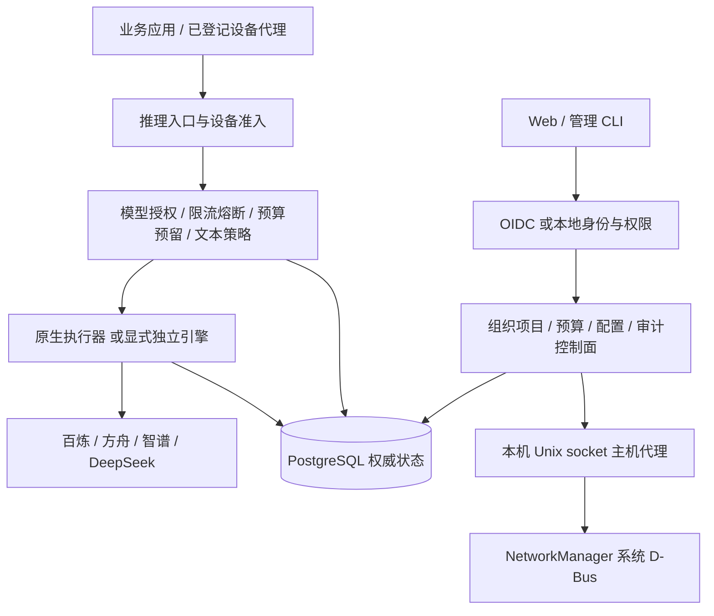

# 产品技术规格

适用版本见 [文档中心](README.md)。下列“已实现”表示基线代码具备该能力，不代表已经通过全部生产、合规或容量验收。

## 1. 产品定位与边界

序衡 AI 治理网关面向企业团队提供统一模型接入、项目密钥、费用约束、终端准入、调用追踪与审计。以组织/项目作为核心治理作用域，PostgreSQL 保存权威状态。控制台、CLI 与服务端 API 共享治理规则。

本产品不是模型训练平台、完整企业 IdP、EDR 或通用内容安全审核系统。没有以开源组件的功能清单替代本产品实装能力；独立 Bifrost 执行器可显式启用，默认原生执行器保留，原生候选包不含独立引擎入口。

## 2. 逻辑架构

管理面与推理面在默认网关中同进程、不同路由；身份、预算、审计不会因为更换执行器而迁入厂商 SDK。主机代理为独立权限边界，网关进程无需以 root 运行。节点管理首版按实例绑定，不是集中式多主机配置平台。

## 3. 功能规格矩阵

| 模块 | 已实现 | 当前限制 |
| --- | --- | --- |
| 接入 | `/v1/chat/completions` 文本 JSON/SSE，`/v1/models` 授权目录 | newapi 模式增加有界客户端函数调用；不承诺多模态、n>1 或其他 OpenAI 全量 API |
| 供应商 | 百炼、方舟、智谱、DeepSeek；固定入口、路由别名、价格版本、凭证托管 | 实际付费账号/模型/账单仍需验收；不允许任意 Base URL |
| 密钥 | 项目密钥一次性明文、摘要存储、授权模型、撤销 | 不是外部厂商凭证；不能作管理身份 |
| 身份 | OIDC 浏览器登录、管理 JWT、CLI Device Flow；独立本地账号模式 | 本地账号不等于 OIDC Provider；外部 IdP 注销联动待完善 |
| 组织治理 | 组织/项目角色、成员停用恢复、部门授权与所有者交接 | 历史授权不等于当前权限；不存在组织管理员自动获得全局权的规则 |
| 预算费用 | 双层预算预留与结算、占额恢复、调额审批、周期、告警、报表、标准账单对账 | 未知费用保留占额；厂商原始账单需转换/验证；不保证个人精确计费 |
| 终端 | 公钥登记确认、短期会话、DPoP 绑定、防重放、撤销、Linux 本地代理 | 无完整设备健康评估、远程软件管控、出口防绕过 |
| 审计 | 管理操作、调用/attempt、项目可选正文、访问留痕、保留清理、哈希链/检查点 | newapi 客户端工具声明/参数/结果已覆盖；多模态尚不覆盖；无外部可信锚定或完整 SIEM/KMS 集成证明 |
| 文本策略 | 字面/正则，输入/输出方向，告警/阻断 | 不是通用语义护栏；输出阻断不等于未发生费用 |
| 系统管理 | CPU/内存/cgroup/网卡/DNS；IPv4/DNS 预览、临时应用、确认/回退 | Linux 普通活动以太网白名单；真实 NM VM 未完成验收 |
| 运维交付 | 健康接口、Prometheus、版本迁移、隔离备份恢复演练、原生候选包 | 无生产容量承诺、跨站容灾证明、正式签名发行 |

## 4. 身份与授权模型

业务身份由 issuer+subject 确定。组织/项目/部门角色约束业务访问；供应商平台管理员、系统管理员、本地账号管理员和内容审计员分别配置或授予，不能混同。

浏览器 OIDC 使用授权码、PKCE、state、nonce 与服务端会话；Cookie 管理写入校验 Origin/CSRF。管理 Bearer JWT、浏览器会话、项目推理密钥、设备会话、厂商 API Key 和监控令牌均有不同用途，不可互换。

本地密码采用 Argon2id 独立盐；初始化/重置强制改密，停用及会话撤销影响后续接纳。在途请求可能已经调用上游，撤销身份不会抹除其费用。

## 5. 费用与一致性模型

金额使用明确币种的整数最小单位。CNY_MICRO：1 元 = 1,000,000 微元；MOCK 用于合成场景，不作为人民币结算依据。预算约束同时作用于组织与项目。

请求先预留费用，再记录派发与物理 attempt，依据有效用量证据结算。request_id 与物理 attempt 是不同层级。请求上下文固定价格版本、周期和部门归属，避免事后配置变更覆盖历史事实。

异常恢复对已派发但结果不明的请求保留占额。标准账单对账需区分导入、审核和结算；双人审核及状态约束阻止未经核查直接修改余额。SDK 接收成功、HTTP 200、流开始返回均不能单独证明最终用量完整。

配置/凭证一致快照与受管执行实例池支持新旧实例排空。该实现不构成自动跨供应商重试承诺；不能用隐式重试制造重复物理调用及费用。

## 6. 内容与管理审计

默认以元数据为主，正文必须按项目显式开启。内容加密与供应商凭证加密使用独立密钥配置；历史密钥版本需要随保留数据和备份一起管理，不能靠数据库密文推导主密钥。

正文查看需要独立权限和理由，先记录访问再解密。正文可能因限额、断流、异常而截断或不完整；记录状态与字节量必须一起解释。内部哈希链不等于对数据库/root 管理员绝对防篡改，外部锚定仍属待验收范围。

系统管理先提交 requested 意图，再调用主机代理，结果记 succeeded/rejected/unknown。数据库与主机之间不是分布式事务；缺少结果或响应异常不自动重放。恢复数据库也不会回滚真实网卡配置。

## 7. 公开接口与集成契约

| 接口域 | 用途 | 认证/注意事项 |
| --- | --- | --- |
| `/v1/chat/completions` | 文本推理 | 项目密钥或设备准入链；受治理检查 |
| `/v1/models` | 可调用模型目录 | 返回授权交集，不是供应商全量模型目录 |
| `/api/v1/...` | 组织、项目、预算、审计、运行管理 | 管理身份及资源授权；写入仍需对应权限 |
| `/auth/...` | 登录、会话、退出 | 按部署模式和 canonical origin 使用 |
| `/health/live` | 进程存活 | 存活不等于供应商可用 |
| `/health/ready` | 当前实例就绪 | 无可用配置或依赖不满足时可返回 503 |
| `/metrics` | 部署级指标 | 默认关闭，独立 Bearer 令牌；不是租户查询接口 |

管理字段、枚举与路径以 [OpenAPI 契约](../../api/openapi/management.json) 为准。不要根据内部结构体推测稳定公开 API。错误应结合状态码、错误信息、request_id 和服务状态定位；409 不代表可以无限重试，503 不代表请求一定未发生费用。

## 8. 数值限制与平台要求

| 项目 | 当前规格或验证情况 |
| --- | --- |
| 工具链 | Go 1.27.3；候选包固定 Node 24.19.0，Web 使用冻结锁文件 |
| 数据库 | PostgreSQL；本地恢复演练客户端/服务端为 17.11，不等于所有版本已验收 |
| 数据库版本 | 本分支当前迁移 0027；追加迁移、校验和、漂移检测、事务锁、拒绝更新版本结构 |
| 供应商模型目录 | 1–32 个模型，整体发布和版本冲突检查 |
| 内容保留/体积 | 1–90 天；每方向 1024–262144 字节；策略固定在记录中 |
| 标准账单导入 | 每批最多 100 条 / 24 KiB；CNY_MICRO 整数金额 |
| 设备会话 | 五分钟短期会话，代理需保持有效管理登录以续签 |
| 系统网络变更 | IPv4 地址最多 8 个、DNS 最多 4 个；90 秒检查点，最后 15 秒拒绝开始确认；确认写入前延长至当前时刻后 60 秒 |
| 主机代理传输 | Unix socket、指定 UID；响应头 16 KiB、正文 1 MiB；严格结果绑定 |
| 候选包 | 原生 Linux amd64/arm64 构建路径，当前只实测 amd64；校验上限 1 GiB / 10000 成员 |

CPU、内存、磁盘的生产最小配置、最大 QPS、并发数、P99、RPO/RTO和可用性 SLA **尚未建立可交付的统一承诺**。应按模型时延、SSE 持续时间、正文审计比例和保留期压测。开发机基准与小型合成数据恢复耗时不能直接作为采购或容量规格。

## 9. 部署与安全边界

建议按企业实际约束部署网关、PostgreSQL、密钥保管、指标与备份，配置正式 HTTPS 与受控出口。当前供应商和内容审计流程要求对应部署/驻留依据，配置声明不代替合同、实地环境或合规评估。

网关以非 root 用户运行；需要主机管理时单独部署 root 代理，经指定 UID 的 Unix socket 接入。NM 变更限制普通以太网和白名单；不执行 shell 网络命令。并发外部配置工具、NM 重启、断电和代理 pending 状态丢失仍是实际验收边界。

默认启动自动迁移会在接受流量前完成检查/升级。分离 DDL 账号时先离线升级，再以 `--schema-mode=check` 启动业务账号。备份恢复是独立流程，不提供自动降级保证。

## 10. 实现依据与剩余验收

| 主题 | 代码/契约依据 | 说明文档 |
| --- | --- | --- |
| 页面入口 | [Console](../../web/src/features/workspace/Console.tsx) | [页面操作手册](user-guide.md) |
| 管理接口 | [OpenAPI](../../api/openapi/management.json) | [管理 API](../management-api.md) |
| 启动/迁移 | [gatewayapp](../../internal/gatewayapp/main.go)、[数据库迁移](../../internal/database/migrate.go) | [入口说明](../engine-entrypoint.md) |
| 账本 | [budget](../../internal/budget/store.go) | [账单对账](../billing-reconciliation.md) |
| 系统权限/代理 | [控制面](../../internal/control/system.go)、[主机代理](../../cmd/host-agent/main.go) | [系统管理](../system-management.md) |
| 恢复门禁 | [演练测试](../../internal/database/restore_drill_test.go) | [备份恢复](../backup-restore.md) |
| 发行门禁 | [验证脚本](../../scripts/verify-release.sh) | [候选发行包](../linux-package.md) |

必须继续完成：真实企业 IdP、四家实际模型和账单样本、终端代理联调及出口策略、NM 专用虚拟机、实际密钥恢复、跨主机故障与容量、依赖授权与正式发行来源核验。完整证据及 CI 状态应逐提交核验，不能用历史绿色运行代替新版本验收。

new-api 显式执行模式提供独立数据面、经审核的模型/渠道绑定、原始用量校验、持久派发记录与事务恢复收据。客户端为受限文本 Chat Completions，上游已验证 OpenAI 兼容、DeepSeek 原生渠道和 Anthropic Messages 协议，SSE 通过 v2 完成证明实时返回内容，配置和未完成的发布门禁见 [接入说明](../new-api-integration.md)。

客户端函数调用的具体边界、原始费用证据及审计语义见 [工具治理说明](../new-api-integration.md#客户端函数调用与审计)。工具由客户端执行，集中工具授权与供应商托管工具尚未实现。
