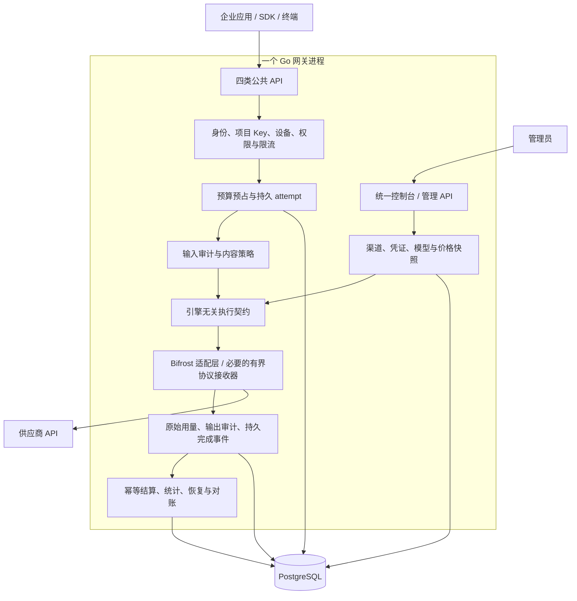

# 单进程自主商业化网关开发规划

日期：2026-11-07。状态：**规划已建立，执行引擎尚未替换，未达到商业发布或 V1.0 验收标准。**

- 开发分支：`feature/v1-single-process-commercial`。
- 起点：`feature/newapi-foundation-validation`，提交 `455b3fa7bb764e36c2680b7433f8856e7bcc43fe`。
- 对照数据面：`jhzhfree/new-api` 的 `feature/enterprise-governance-integration`，提交 `934d85c3cd6f8eb0ef51514cb833ce5719cc6531`。
- 现有可嵌入候选：`modules/engine`，Bifrost Core 固定 `v1.14.1`；该版本是已有验证起点，不代表最新版本或最终商业发布版本。
- 本文件是新分支的目标、顺序和验收依据；[V1 交付跟踪](v1-delivery.md)和各 ADR 中的旧测试证据继续作为历史记录，不能直接计入本分支新引擎验收。

## 1. 目标与边界

交付一个可安装、可升级、可运维的企业 AI 网关：一个 Go 网关进程承载管理 API、公共推理 API、企业治理、执行引擎和后台恢复任务；一个管理控制台维护供应商、模型、价格、权限和审计策略。

自主商业化目标是：自有产品功能、数据模型和发布周期可独立演进；运行不依赖 new-api 服务、Bifrost Enterprise 或第三方商业控制台；拟分发的依赖逐项满足商业分发方式。开源 Core 的宽松许可不代替全依赖、代码来源和实际分发审查。

首版继续采用已确认的四类受控 API 范围，保持现有企业治理要求。首批验收负载为 20 路并发；目标机器为 32 GiB Linux，用户描述的“4核8c”仍待确认具体 CPU 拓扑。目标机器未准备，本地 4 vCPU／16 GiB 证据只作为开发基线，不承诺生产 SLA。

“单进程”的边界：

- 每个网关实例只有一个业务进程；不启动 new-api 子进程，不通过本机 HTTP 回连另一个推理进程。
- PostgreSQL 是外部基础服务。外部 OIDC IdP 可选；离线部署保留已有本地账号能力。
- DNS／网卡修改继续由隔离的特权 host-agent 经 Unix socket 执行；不让网关持有主机管理员权限。终端上的设备 Agent 也不是网关执行子进程。
- 后续可部署多个相同的单进程实例，横向扩容与单实例内部结构不冲突。

## 2. 底座选择与代码复用

采用 **现有企业控制面 + 引擎无关执行契约 + Bifrost Core 候选**。先验证已有固定版本是否能满足关键契约；需要升级时只选择固定发布版，记录差异并重跑契约，不直接跟随 dev 分支。

| 来源 | 复用或参考内容 | 处理方式 |
| --- | --- | --- |
| 当前治理主工程 | 身份、项目 Key、组织/部门/项目权限、预算账本、价格、报表、终端、审计、系统管理、Web/CLI/TUI | 逐项核查来源与当前测试后复用，维护唯一业务实现 |
| `modules/engine` | 执行接口、Bifrost 适配、受管快照、实例池、关闭/取消、严格 SSE 接收 | 作为候选基础；不能将 Chat 局部验证外推为四协议全部支持 |
| 当前 new-api 桥接经验 | attempt 状态、原始 usage、完成证据、幂等收据、配置指纹、故障与治理测试场景 | 抽取自有业务契约；逐文件确认来源后移植适用实现，替换 HTTP/数据面身份依赖 |
| new-api 上游 | 渠道生命周期、模型映射、供应商差异、计费边界经验 | 参考功能和公开协议；不把 AGPL 代码直接复制到目标商业发行物，不将改名视为消除许可义务 |
| Bifrost 开源 Core | 供应商调用、转换、取消、流式、扩展接口 | 固定版本，通过适配层使用；企业插件、二进制和商业功能单独核验 |
| LiteLLM | 多维费用、模型价格、缓存类别、标签与成本归集体验 | 参考产品设计和公开协议；MIT 与 enterprise 目录分开审查 |
| OmniRoute | 编码工具接入、连接状态、多级故障处理体验 | 有选择地参考；不引入 Node 运行时或订阅账号共享作为 V1 基础能力 |
| Higress/APISIX | 配置发布、限流、可观测性、插件顺序和流量治理 | 参考设计；不引入第二套网关运行时 |

最终发行物只启用一种主执行引擎。迁移期间保留旧分支和必要开发对照测试；生产请求只选择一种执行路径，不做真实请求双发，也不在未知费用时自动切换引擎重试。

## 3. 目标结构

图表示逻辑责任，不要求重排当前已验证的中间件顺序；实现时保持鉴权、输入策略拒绝和预算释放的既有安全语义。关键要求是任何实际派发前完成企业准入与持久预算/attempt，成功结束前完成所需证据与审计封存。

业务包不暴露 Bifrost 类型；SDK 依赖集中在适配层。评估复用 `RuntimeEngine`、`ProviderExecutor` 和 `execution`，在 M1 明确统一接口，避免长期保留三套近似契约。执行契约至少描述：

- 请求：request/attempt ID、租户/项目授权结果、渠道与配置版本、协议、模型、服务端参数和费用上限、取消/截止时间。
- 事件：派发状态、内容增量、原始用量及来源/完整性、明确的协议终止、失败/取消；限定大小并支持背压。
- 生命周期：初始化、配置发布、停止接纳、排空/取消、关闭、恢复就绪。
- 治理只接受适配层生成的可信上下文；客户端请求头不能创建内部权限或绕过渠道绑定。

需要显式拆开的现有耦合包括：`internal/gateway/providers.go` 中 Responses/Messages 对 new-api 渠道标识与证据能力的检查，改为统一的受治理渠道/能力契约并保留拒绝逻辑；`internal/newapibridge` 中基于 URL、内部请求头和 HTTP trailer 的执行/恢复通信，改为类型化事件与稳定引擎标识；管理端针对 new-api 的渠道服务，改为统一渠道服务接口。不能只替换一次推理调用而遗漏配置、readiness、恢复与管理链路。

## 4. V1 功能范围

| 模块 | 交付内容 | 退出条件 |
| --- | --- | --- |
| 身份与 Token | 外部 OIDC、离线本地账号、组织/项目/部门权限、项目 Key、失效与撤销、最小权限 | 跨租户/过期/撤销/越权均拒绝；本地账号不冒充完整 OIDC Provider |
| 统一供应商管理 | 平台管理员管理供应商/渠道、加密密钥、启停、模型映射、参数能力、配置与价格审核发布 | 用户只使用网关地址与项目 Key；供应商密钥不下发客户端、不回显、不入日志 |
| 费用治理 | 预算预占、已结算/未知费用、价格版本、缓存细分、项目/部门/模型/渠道统计、标准账单对账与审批 | 金额整数与币种明确；仅使用可信原始计量；账本、收据、审计可关联 |
| 终端管控 | 复用设备登记、持有证明、短期会话、防重放、撤销与项目设备策略 | 新引擎所有入口均经过设备策略；真实 Agent/出口防绕过单独验收 |
| 内容审计 | 输入/输出/工具关联、加密采集、检查点/封存、分权查看、留痕、保留与删除 | 关键失败不伪装成功；可区分观察、持久化、封存；为护栏提供同步/异步扩展口 |
| 系统管理 | CPU/内存等监控、健康状态，Linux/NetworkManager 的受控 DNS/网卡操作 | 特权边界保持；写操作权限、审计、回滚及真实主机验收 |
| 运维与升级 | 单进程发布包、自动数据库升级、指标/告警、备份恢复与回退说明 | 新库/旧库/失败恢复通过，未就绪拒绝推理，提供产品和运维手册 |

首批引擎验收供应商范围：OpenAI 兼容、DeepSeek、Anthropic；既有百炼/方舟/智谱能力建立迁移矩阵，只有真实固定接口契约通过后才在新发行物中标记支持，不因代码存在自动放行。

| 公共协议 | 保持的受控范围 | 不纳入首版 |
| --- | --- | --- |
| Chat Completions | 文本 JSON/实时 SSE、审核客户端函数工具、审核内联图片 | 服务端托管工具、外部图片 URL、音视频 |
| Embeddings | 有界文本批量、float 向量、input-only 用量 | Token-ID 数组、二进制输入、其他编码 |
| Responses | 无状态文本、字符串/有界消息列表、JSON/实时 SSE | 服务端状态/检索、工具、媒体等未验收语义 |
| Messages | 文本 JSON、审核 Anthropic 实时 SSE | 工具、媒体、thinking、beta、缓存控制/引用字段 |

缓存读写及 5 分钟/1 小时类别的计量与定价按原始证据和模型能力明确配置，不因请求未开放缓存控制而省略供应商返回的费用类别。不支持的协议/字段在派发前拒绝；这不是完整 OpenAI/Anthropic 或全部编码客户端兼容承诺。

自建可对外签发标准 OIDC 的身份服务、图像生成/音视频任务、自动模型路由优化、完整 EDR/MDM、语义缓存、MCP 托管工具和完整商业订阅商城作为后续范围，另行明确需求与验收成本。

## 5. 费用、审计和恢复不变量

1. 一个业务请求关联明确的物理 attempt；缺失证据不等于零费用，不用 SDK 补零或估算冒充原始 usage。
2. 首版默认一次物理派发；显式禁用不受治理的 SDK/provider 重试、自动回退和重定向。未来重试必须分别预占/记录每次物理尝试。
3. 预算与价格快照在派发前持久化；改价、换密钥、改变模型映射不能追溯改变在途请求的结算与路由。
4. 原始用量保留来源、完整性、缓存类别与计数一致性；未知类别/矛盾/越界计数进入可解释状态，不猜测填充。
5. 完成事件持久化后才能驱动成功结算；账本更新与幂等收据同事务，处理重复和迟到事件。
6. 即使同进程也保留持久 outbox/恢复扫描。内存通知只能加快消费，不能作为唯一结算证据。
7. 客户端取消、供应商超时、EOF、审计失败与进程退出分别记录；流式终止消息只在协议、计量及当前策略要求的审计条件满足后发出。
8. 供应商已接受请求但进程在保存最终用量前崩溃，仍可能无法知道实际费用；保留未知占额并对账，不承诺外部调用 exactly-once。
9. 内容审计保存请求、上游变换和返回内容之间必要的关联；工具参数/结果与图片元数据按策略处理，向量输出不冒充可文本审计内容。明文密钥与正文不进入默认运行日志。

## 6. 数据与升级策略

保留 PostgreSQL 为唯一企业业务数据库。将 new-api 特定的 HTTP 地址、事件命名和渠道绑定逐步转为稳定的引擎/渠道标识；用新的迁移维护兼容映射，不覆盖已发布迁移或历史证据。

- 默认启动自动迁移：事务锁、版本/校验和/结构漂移验证、失败回滚；完成必要恢复与配置检查后才允许推理。
- 保留 `--schema-mode=check` 和独立 `migrate up|status|check`，支持升级与业务账号分离。
- 新迁移从实现时的最新编号后追加；规划时最新是 0031，不能在并行开发中硬编码假定下一个编号。
- 迁移组织/项目/Key、预算历史、价格、审计、设备与凭证版本；新旧渠道 ID 显式映射，实际秘密通过受控导入或重新录入完成，禁止把 new-api 明文秘密转存到操作日志。
- 切换前排空旧执行链，并对未完成/未知请求建立清单；新引擎不能替旧执行器编造完成证据。尚需旧事件来源的恢复必须完成或显式移交对账后才能解除依赖。
- 新库、从当前 0031 升级、重复/并发启动、历史账务保留、迁移失败、版本过新、备份恢复均纳入测试。
- 回退按兼容矩阵执行；不承诺旧二进制能直接访问新 schema，不自动降级数据库。

## 7. 商业交付与来源核验

M0 建立按文件/模块/资产划分的来源表：来源仓库与提交、许可证、修改记录、用途、是否进入发行物、NOTICE/源码交付义务和核验状态。未核验的复制代码不能标为“自研”。

重点检查：

- 当前主工程、Bifrost 模块、历史 new-api 适配代码、前端组件/图标/字体、脚本、生成代码、测试 fixture 和构建镜像。
- Bifrost 开源 Apache-2.0 范围与企业组件分离；LiteLLM MIT 与 enterprise 代码分离；禁止因为目录同在公开仓库就视为同一许可。
- new-api AGPL/NOTICE 的代码与衍生关系逐项判断。移除运行依赖或改名不能消除既有义务；存在问题时采用独立实现、替换依赖或取得覆盖实际分发的授权。
- 区分运行、构建和测试依赖；最终包不依赖 new-api fixture 或后台服务，开发对照资料是否分发须单独记录。
- 生成实际构建的 SBOM、依赖版本/校验和、第三方许可和 NOTICE，检查已知漏洞及严重问题处置；保留源码来源与补丁跟踪。
- 自有代码的权属和对客户交付条款单独确定；规划分支建立不等于已取得商业授权，也不修改仓库可见性或自动变更项目许可证。

## 8. 分阶段实施与工时

估算仅覆盖上述 V1 受控范围，包含开发集成和必要测试；真实账号、硬件、合同/授权等待不计入开发工期。M0/M1 结束后按证据重估。各阶段完成后验证、提交、推送并记录远端 CI；本轮只建立规划，不开始下面的代码实施。

| 阶段 | 工作包与交付 | 验收门槛 | 人日 |
| --- | --- | --- | ---: |
| P0 规划基线 | 分支、目标架构、范围、里程碑、风险与状态入口 | 文档与现有源码状态区分；旧分支不变 | 本轮 |
| M0 来源与差距基线 | 来源/依赖/发行清单；四协议逐项差距；SDK 版本决定；统一契约草案 | 商业组件边界明确，关键证据接口可行；关键来源疑点有处置路径 | 3–5 |
| M1 单进程执行闭环 | 一个入口/生命周期；严格文本 Chat JSON/SSE；原始 usage；持久完成事件/恢复；配置快照 | 单 PID、无 new-api 连接；预算→派发→审计→结算闭环；强杀不误退款/重放 | 6–10 |
| M2 四协议与细分计费 | Embeddings、Responses、Messages；Chat 工具/内联图片；缓存类别；真实协议合成测试 | 每种受控协议均通过正常、拒绝、断流、缺失用量和故障测试 | 10–16 |
| M3 统一渠道与费用产品 | 统一加密凭证/渠道发布；多 Key 选择边界；费率/报表/对账；历史绑定迁移 | 管理端闭环；配置冲突拒绝、轮换不影响在途、费用明细与账本一致 | 7–12 |
| M4 企业治理回归 | Key/OIDC/本地账号/设备/权限；内容查看/保留/删除；护栏接口；系统管理 | 四协议无治理绕过；故障语义、访问留痕、终端撤销和加密恢复通过 | 6–10 |
| M5 开发候选交付 | 20 并发/长流/故障/恢复；Linux 包；自动升级；SBOM/NOTICE；操作/技术/运维手册 | 全量门禁和单进程包验证通过；外部验收项单列，发布 development_candidate | 8–12 |
| 合计 | M0–M5 初步范围 | 未含重大依赖重构或范围扩展 | **40–65** |

计划资源预留按 **45–75 人日**准备，覆盖兼容问题和正常返工；两名 Go 开发、测试部分投入时估计 6–9 周，需在 M1 后修订。M0/M1 的关键验证先于协议扩展；M2 可与 M3 的非依赖页面/数据设计并行，端到端验收仍按依赖执行。这是工程排期建议，不授权本轮启动并行代理或后续实施。

若 Bifrost 原始用量、流式完成、实际派发钩子不满足要求：先评估一个范围明确的适配层/上游补丁；若需要长期重写大部分供应商处理，则暂停后续扩展并重新比较成本。不得以放宽计量或审计契约换取里程碑通过。

## 9. 验证与发布门槛

| 类别 | 必测内容 |
| --- | --- |
| 身份/权限 | 跨组织/项目、撤销与过期 Key、模型权限、管理权限、设备失效/重放 |
| 费用 | 并发抢占预算、整数溢出边界、历史价格、原始/缺失/冲突用量、缓存细项、迟到与重复事件 |
| 协议/流式 | 四 API 请求白名单、JSON/SSE、工具关联、图片边界、首段及时返回、背压、断流、终止证明 |
| 故障 | 派发前后和结算前后 SIGKILL；数据库/审计不可用；配置刷新失败；重启恢复；无隐式重放 |
| 升级 | 新库和当前版本升级、并发迁移、失败回滚、漂移/新版本拒绝、check 模式、备份恢复 |
| 资源 | 20 路并发、长流和持续负载、峰值内存/CPU/连接/goroutine、过载拒绝、关闭回收 |
| 页面/SDK | 管理员从渠道配置到授权/Key/调用/费用/审计的完整操作；已有 CLI/TUI；真实 SDK 对合成供应商 |
| 交付 | 一份产品入口与单进程安装；无 new-api 运行依赖；固定依赖、包校验、SBOM/NOTICE、操作与运维说明 |

后端阶段运行根 `scripts/verify.sh`（固定 Go 工具链、真实隔离 PostgreSQL、race/vet/模块和契约检查），明确覆盖嵌套模块；Web 阶段冻结安装、类型检查、构建及真实 PostgreSQL/身份 fixture 浏览器回归。不增加仅断言实现细节的测试，不省略失败或跳过的集成项。

现有 CI 会构建 new-api 对照 fixture。M1–M3 逐步建立新引擎自己的合成供应商、进程和故障测试；在等价场景迁移且证明发行物独立后，从该分支必需发布链移除旧依赖，不通过直接删除测试获得绿色 CI。旧分支继续保留双进程回归证据。

性能分别记录基础执行、预算/账本、设备与内容审计启用后的成本；统计网关自身延迟、首 Token 延迟、错误率、恢复积压与资源趋势。没有目标硬件实测前不发布延迟/QPS 保证，也不采用开源宣传数字。

商业发布前外部验收仍需：真实供应商凭证及费用预算/账单、企业 IdP/终端接口、目标 Linux/NetworkManager 机器、主密钥备份恢复、实际发行授权审查和生产切流安排。开发阶段不调用未授权付费模型，不修改生产网卡/数据库，不自动打 V1.0 标签。

## 10. 当前进度与下一步

| 项目 | 状态 |
| --- | --- |
| 新分支与开发规划 | 本轮建立 |
| 既有企业功能与 Bifrost 模块 | 继承基线；未在本轮重新验收 |
| 来源清单、依赖许可与商业发行审查 | M0 待执行 |
| 统一执行接口与单进程四协议 | M1/M2 待实施 |
| 统一渠道和历史数据迁移 | M3 待实施 |
| 全量回归、性能、单进程候选包 | M4/M5 待验收 |
| 真实供应商/身份/终端/目标硬件与生产发布 | 外部验收待具备条件 |

下一实施切片：完成 M0 来源/差距清单与版本决定，再以 M1 文本 Chat 的单进程持久闭环验证核心假设。每阶段记录提交、精确工具链/命令、通过/失败/跳过、远端 CI 和剩余问题。

## 11. 证据与参考

- 当前自有代码：[执行接口](../internal/gateway/handler.go)、[应用生命周期](../internal/gatewayapp/main.go)、[持久对账](../internal/newapibridge/journal.go)、[恢复消费](../internal/newapibridge/recovery.go)、[版本迁移](../internal/database/migrate.go)。
- 已有候选：[Bifrost 模块](../modules/engine/README.md)、[严格流式接收 ADR](../modules/engine/docs/adr/0005-strict-stream-reception.md)、[受管入口](engine-entrypoint.md)。
- 产品边界：[V1 交付跟踪](v1-delivery.md)、[new-api 部署/协议验收](new-api-deployment.md)、[内容审计](content-audit.md)、[系统管理](system-management.md)。
- 上游：[Bifrost Apache-2.0](https://github.com/maximhq/bifrost/blob/d9f5ae0474811cd1ff38b6fb76a2ef83c6431e2d/LICENSE)、[Go SDK](https://docs.getbifrost.ai/quickstart/go-sdk/setting-up)、[企业功能边界](https://docs.getbifrost.ai/enterprise/overview)。
- 参考授权：[new-api LICENSE](https://github.com/jhzhfree/new-api/blob/934d85c3cd6f8eb0ef51514cb833ce5719cc6531/LICENSE)及[NOTICE](https://github.com/jhzhfree/new-api/blob/934d85c3cd6f8eb0ef51514cb833ce5719cc6531/NOTICE)、[LiteLLM 核心许可](https://github.com/BerriAI/litellm/blob/main/LICENSE)及[企业目录许可](https://github.com/BerriAI/litellm/blob/main/enterprise/LICENSE.md)。

引用证明对应源码/文档内容，不代表这些项目已通过本产品的发布验收；依赖升级时重新核验许可、功能与契约。
