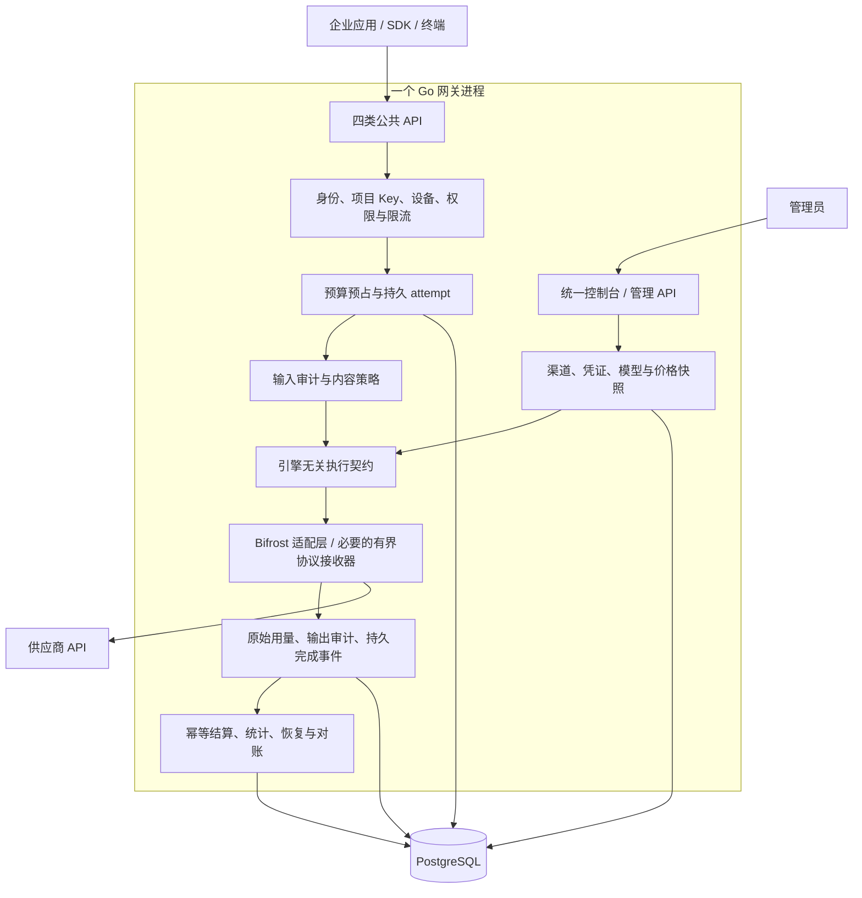

# 单进程自主商业化网关开发规划

日期：2026-11-07。修订：**V2，复用优先，用户已批准实施。** 用户随后明确“开始开发落地，产品前端页面尽量更专业”。现进入单进程产品入口、控制台与依赖核验首阶段；不将局部交付视为整体商业发布或 V1.0 验收完成。执行情况见 [V1 交付跟踪](v1-delivery.md)。

- 开发分支：`feature/v1-single-process-commercial`。
- 起点：`feature/newapi-foundation-validation`，提交 `455b3fa7bb764e36c2680b7433f8856e7bcc43fe`。
- 对照数据面：`jhzhfree/new-api` 的 `feature/enterprise-governance-integration`，提交 `934d85c3cd6f8eb0ef51514cb833ce5719cc6531`。
- 现有可嵌入候选：`modules/engine`，Bifrost Core 固定 `v1.14.1`；该版本是已有验证起点，不代表最新版本或最终商业发布版本。
- 本文件是新分支的目标、顺序和验收依据；[V1 交付跟踪](v1-delivery.md)和各 ADR 中的旧测试证据继续作为历史记录，不能直接计入本分支新引擎验收。

## 本次提交确认的决定

1. Bifrost 开源 Core 为首选供应商执行组件，优先使用其公开 SDK；不开发新的通用 AI 引擎，不引入 Enterprise 组件作为必需依赖。
2. 当前工程中来源明确、符合验收的企业功能、数据库和页面直接沿用；只改执行接缝、必要协议和证据缺口，不做全仓架构重写。
3. V1 保持四类受控 API、Token/费用/终端/内容审计/系统管理/自动升级；新增能力和限制见第 4 节，均为拟交付承诺，不是当前已经实现声明。
4. 标准本地 OIDC 通过可选的客户自建 Keycloak 接入；已有离线本地账号继续可用，不开发 OIDC 发证服务器。Keycloak 属配套基础服务，不合并到网关 Go 进程。
5. 默认商业发行路径不依赖 new-api AGPL 代码或未授权企业组件；已有代码与依赖须按来源审查，不承诺未经核验的“零授权风险”。
6. 按用户已确认的阶段实施、验证、提交和推送。每阶段记录实际结果与剩余缺口，外部系统与生产验收另行记录。

## 1. 目标与边界

交付一个可安装、可升级、可运维的企业 AI 网关：一个 Go 网关进程承载管理 API、公共推理 API、企业治理、执行引擎和后台恢复任务；一个管理控制台维护供应商、模型、价格、权限和审计策略。

自主商业化目标是：自有产品功能、数据模型和发布周期可独立演进；网关运行不依赖 new-api 服务、Bifrost Enterprise 或第三方商业控制台；拟分发的依赖逐项满足商业分发方式。采用成熟组件的公开接口，少改上游源码，减少自维护分支。开源 Core 的宽松许可不代替全依赖、代码来源和实际分发审查。

首版继续采用已确认的四类受控 API 范围，保持现有企业治理要求。首批验收负载为 20 路并发；目标机器为 32 GiB Linux，用户描述的“4核8c”仍待确认具体 CPU 拓扑。目标机器未准备，本地 4 vCPU／16 GiB 证据只作为开发基线，不承诺生产 SLA。

“单进程”的边界：

- 每个网关实例只有一个业务进程；不启动 new-api 子进程，不通过本机 HTTP 回连另一个推理进程。
- PostgreSQL 是外部基础服务。OIDC IdP 可选，优先复用客户现有 IdP；需要标准本地 OIDC 时提供 Keycloak 接入配置与验收说明；离线部署保留已有本地账号能力。
- DNS／网卡修改继续由隔离的特权 host-agent 经 Unix socket 执行；不让网关持有主机管理员权限。终端上的设备 Agent 也不是网关执行子进程。
- 后续可部署多个相同的单进程实例，横向扩容与单实例内部结构不冲突。

## 2. 底座选择与代码复用

采用 **现有企业控制面 + 引擎无关执行契约 + Bifrost Core 候选**。先验证已有固定版本是否能满足关键契约；需要升级时只选择固定发布版，记录差异并重跑契约，不直接跟随 dev 分支。

| 来源 | 复用或参考内容 | 处理方式 |
| --- | --- | --- |
| 当前治理主工程 | 身份、项目 Key、组织/部门/项目权限、预算账本、价格、报表、终端、审计、系统管理、Web/CLI/TUI | 逐项核查来源与当前测试后复用，维护唯一业务实现 |
| `modules/engine` | 执行接口、Bifrost 适配、受管快照、实例池、关闭/取消、严格 SSE 接收 | 作为候选基础；不能将 Chat 局部验证外推为四协议全部支持 |
| 当前 new-api 桥接经验 | attempt 状态、原始 usage、完成证据、幂等收据、配置指纹、故障与治理测试场景 | 抽取自有业务契约；逐文件确认来源后移植适用实现，替换 HTTP/数据面身份依赖 |
| new-api 上游 | 渠道生命周期、模型映射、供应商差异、计费边界经验 | 参考功能和公开协议；不把 AGPL 代码直接复制到目标商业发行物，不将改名视为消除许可义务 |
| Bifrost 开源 Core | 供应商调用、转换、取消、流式、公开扩展接口、经审核的 Key 选择 | 直接使用固定 SDK；优先配置接入，必要时做小范围适配；企业插件、二进制和商业功能单独核验 |
| Keycloak（可选配套） | 本地标准 OIDC、账号/MFA、LDAP/AD 联合身份等现成功能 | 通过标准 OIDC 接入，不复制服务端代码；V1 验收登录/退出/角色映射，不承诺所有企业目录同步功能 |
| LiteLLM | 多维费用、模型价格、缓存类别、标签与成本归集体验 | 参考产品设计和公开协议；MIT 与 enterprise 目录分开审查 |
| OmniRoute | 编码工具接入、连接状态、多级故障处理体验 | 有选择地参考；不引入 Node 运行时或订阅账号共享作为 V1 基础能力 |
| Higress/APISIX | 配置发布、限流、可观测性、插件顺序和流量治理 | 参考设计；不引入第二套网关运行时 |

最终发行物只启用一种主执行引擎。迁移期间保留旧分支和必要开发对照测试；生产请求只选择一种执行路径，不做真实请求双发，也不在未知费用时自动切换引擎重试。

当前实现补充（2026-11-08）：原始证据测试确认 SDK capture 在 JSON 解析后压缩空白；按 [ADR 0013](../modules/engine/docs/adr/0013-bounded-json-reception.md) 将 Chat/Embedding 接收共用为有限适配，仍直接复用 SDK 网络保护、类型和规范化。当前产品不再使用 Core worker/Account 派发；表中调用/Key 调度是规划复用目标，不代表已全部实现。后续若出现大量供应商重写，仍执行本规划的重新评估门禁。

### 2.1 减少开发量的执行规则

按“已有合格实现直接沿用 → 成熟组件配置接入 → 薄适配 → 明确缺口的小范围开发”的顺序决策。每个工作项记录现有实现、目标差距和为何不能直接复用；没有功能缺口的模块只做受影响回归。

- 不重新开发供应商 HTTP SDK、分词库、加密算法、OIDC 服务端、数据库迁移框架或完整监控平台。
- 复用 Bifrost 协议转换与请求执行；已有严格 SSE 接收器仅用于 SDK 暂不能提供完整证据的受控路径，不扩大为一套通用供应商框架。完整原始用量获取失败是阻塞，不能以补零替代。
- 保留现有企业账本作为唯一金额权威，使用 Bifrost 作为执行组件；不再接入第二套预算/钱包/扣费和用户系统后进行同步。
- 统一供应商页面优先改造现有 `ProviderPanel`，参考已有 `NewAPIProviderPanel` 的自有交互与版本处理；不整体搬入 Bifrost 或 new-api 控制台再重做权限与导航。
- 保留现有 `RuntimeEngine`/`ProviderExecutor` 的业务接缝，通过适配解决差异；V1 不以形成通用公开 SDK、合并所有历史接口或消除所有技术债为目标。
- 保留既有 SQL 迁移、账单 CSV、报表和人工审批流程；V1 不新增所有供应商原生账单自动抓取，不增加任意历史数据库迁移工具。
- CPU/内存/网卡监控与 NetworkManager 控制沿用当前实现和系统接口；指标对接标准采集端，V1 不自建时序数据库/告警平台。
- 不为展示“复用比例”宣称未经测量的百分比。以减少新增运行时、复制源码、上游补丁和重复业务实现为实际指标。

### 2.2 为什么保留部分自有治理代码

当前组织/项目预算预占、未知费用处理、持久审计、设备准入已经有实现与历史回归，直接沿用比迁往第三方企业版再适配更省工作。Bifrost 的插件与日志、LiteLLM 的费用统计可以参考，但不把普通用量统计当作本产品的持久结算证据。不要求在 V1 重新开发这些业务模块；实际发现的来源、正确性或安全缺口单独列项修复。

## 3. 目标结构

图表示逻辑责任，不要求重排当前已验证的中间件顺序；实现时保持鉴权、输入策略拒绝和预算释放的既有安全语义。关键要求是任何实际派发前完成企业准入与持久预算/attempt，成功结束前完成所需证据与审计封存。

业务包不暴露 Bifrost 类型；SDK 依赖集中在适配层。复用 `RuntimeEngine`、`ProviderExecutor` 和 `execution` 的已有边界，在 M1 明确一条产品执行链；暂不开展无业务必要的全接口重构。执行契约至少描述：

- 请求：request/attempt ID、租户/项目授权结果、渠道与配置版本、协议、模型、服务端参数和费用上限、取消/截止时间。
- 事件：派发状态、内容增量、原始用量及来源/完整性、明确的协议终止、失败/取消；限定大小并支持背压。
- 生命周期：初始化、配置发布、停止接纳、排空/取消、关闭、恢复就绪。
- 治理只接受适配层生成的可信上下文；客户端请求头不能创建内部权限或绕过渠道绑定。

需要显式拆开的现有耦合包括：`internal/gateway/providers.go` 中 Responses/Messages 对 new-api 渠道标识与证据能力的检查，改为统一的受治理渠道/能力契约并保留拒绝逻辑；`internal/newapibridge` 中基于 URL、内部请求头和 HTTP trailer 的执行/恢复通信，改为类型化事件与稳定引擎标识；管理端针对 new-api 的渠道服务，改为统一渠道服务接口。不能只替换一次推理调用而遗漏配置、readiness、恢复与管理链路。

## 4. V1 功能范围

下表是**确认后的 V1 软件交付范围**；每项须在新执行链验收，不能把旧分支通过视为自动通过。

| 交付模块 | V1 可操作能力 | 主要复用来源 / 必要增量 | 验收边界 |
| --- | --- | --- | --- |
| 统一模型网关 | 四类受控 API，JSON/实时 SSE，Chat 客户端函数与审核内联图片 | Bifrost SDK + 现有协议校验/转换/执行适配；补齐证据接缝 | 支持矩阵逐协议验证，不宣称全部原生 API 或编码客户端兼容 |
| 供应商与渠道 | 管理员录入/轮换密钥、启停渠道、模型映射、能力限制、配置审核发布、状态展示 | 现有 provider/凭证库/页面 + Bifrost Account/Key 接口 | 单一管理入口；密钥加密、不回显；审核渠道内 Key 选择，不跨渠道隐式重放 |
| Token 与访问控制 | 项目 Key 创建、一次展示、过期、撤销、换发，模型权限、限流与项目预算约束 | 现有 identity/control/限流；补齐新入口接线 | 项目 Key 与供应商 Key 分离；换发沿用创建新 Key＋撤销旧 Key，V1 不另造自动轮换平台 |
| 身份与组织 | 组织/部门/项目成员与角色；外部 OIDC；离线本地账号；可选本地 Keycloak OIDC | 现有 OIDC/本地账号和 RBAC；成熟 Keycloak 配置接入 | 本地 OIDC 依赖可选配套 IdP；LDAP/AD 自动全量同步、SCIM 不列为首版承诺 |
| 预算与计费 | 组织/项目预算、月度额度、预占/结算/未知费用、价格版本、缓存细分、调额审批与通知 | 现有账本、审批和通知；适配 SDK 原始 usage | 以现有人民币计价为首版口径；不新增自动汇率/多币种总账；不把估算当真实用量 |
| 费用统计与对账 | 按组织/部门/项目/模型/渠道/时间查询已有报表，调用明细、标准 CSV 账单导入和差异处理 | 现有报表与对账页面；补齐新引擎归属字段 | 汇总可回查明细；V1 不承诺逐厂商账单自动抓取、财务发票/支付 |
| 终端准入 | 设备登记、用户/设备绑定、持有证明、短期会话、防重放、撤销与项目设备策略；已有 CLI/TUI | 现有设备/终端代码和测试 | 网关准入不等于完整 EDR/MDM；实际终端 Agent、流量防绕过单独验收 |
| 内容与操作审计 | 输入/输出/工具关联，加密采集、检查点/封存、分权查看、查询、留痕、保留/删除 | 现有 audit/content 与页面；新流式事件接线 | 图像按已审核策略处理；向量不作文本审计；缺证据/审计失败可解释且不伪装成功 |
| 基础内容管控 | 复用已有输入/输出关键词规则及告警/阻断/脱敏能力，预留外部护栏接口 | 现有 keyword/策略；不自研大模型安全引擎 | JSON/SSE 分别列能力边界；不承诺全语义注入识别、合规认证或未经验证的流式脱敏 |
| 系统与运维 | CPU/内存/网络状态、健康探针、已有运行指标；NetworkManager DNS/网卡受控操作 | 当前 systemhost、独立 host-agent 和系统接口 | 只承诺 Linux/NetworkManager；网络写操作需真实主机权限、审计和回退验收 |
| 安装、升级与文档 | 一个网关进程的 Linux 安装包、控制台、启动自动迁移、备份恢复/回退手册、SBOM/NOTICE、操作与技术规格 | 现有打包/迁移/文档/CI；统一入口和发布清单 | 数据库和可选 IdP/特权 Agent 为配套服务；旧库兼容以明确版本矩阵为准 |

首批引擎验收供应商范围：OpenAI 兼容、DeepSeek、Anthropic；既有百炼/方舟/智谱能力建立迁移矩阵，只有真实固定接口契约通过后才在新发行物中标记支持，不因代码存在自动放行。

| 公共协议 | 保持的受控范围 | 不纳入首版 |
| --- | --- | --- |
| Chat Completions | 文本 JSON/实时 SSE、审核客户端函数工具、审核内联图片 | 服务端托管工具、外部图片 URL、音视频 |
| Embeddings | 有界文本批量、float 向量、input-only 用量 | Token-ID 数组、二进制输入、其他编码 |
| Responses | 无状态文本、字符串/有界消息列表、JSON/实时 SSE | 服务端状态/检索、工具、媒体等未验收语义 |
| Messages | 文本 JSON、审核 Anthropic 实时 SSE | 工具、媒体、thinking、beta、缓存控制/引用字段 |

缓存读写及 5 分钟/1 小时类别的计量与定价按原始证据和模型能力明确配置，不因请求未开放缓存控制而省略供应商返回的费用类别。不支持的协议/字段在派发前拒绝；这不是完整 OpenAI/Anthropic 或全部编码客户端兼容承诺。

自研 OIDC 发证服务、图像生成/音视频任务、自动模型路由优化、完整 EDR/MDM、语义缓存、MCP 托管工具、全厂商账单自动对接、全量渠道迁移和商业订阅商城作为后续范围，另行明确需求与验收成本。V1 不进行全新 UI 重设计、通用插件市场或多执行器平台开发。

### 4.1 实际交付物与版本命名

- 产品软件：单进程网关、现有统一控制台、既有 CLI/TUI；需要主机网络控制时提供独立 host-agent 的安装配置。
- 配套配置：PostgreSQL、客户 OIDC/可选 Keycloak 接入示例、供应商/价格/策略模板，全部使用无秘密占位配置。
- 运维交付：安装/升级/备份/恢复/回退说明、监控指标、故障处理、数据库版本矩阵、软件版本与校验和。
- 产品交付：页面操作手册、四协议支持/限制矩阵、费用/内容审计语义、技术规格、测试报告和剩余外部验收清单。
- 商业交付资料：来源清单、SBOM、第三方许可证和 NOTICE、自有代码/资产权属核验记录、严重依赖问题处置记录。

开发环境全部门禁通过但外部条件不齐时，交付 **V1-RC / development_candidate**；真实供应商账单、企业身份/终端、目标硬件、主机网络与发行授权验收完成后才标正式 **V1.0**。不能为了满足版本名称将外部条件直接勾选通过。

## 5. 费用、审计和恢复不变量

1. 一个业务请求关联明确的物理 attempt；缺失证据不等于零费用，不用 SDK 补零或估算冒充原始 usage。
2. 首版默认一次物理派发；显式禁用不受治理的 SDK/provider 重试、自动回退和重定向。未来重试必须分别预占/记录每次物理尝试。
3. 预算与价格快照在派发前持久化；改价、换密钥、改变模型映射不能追溯改变在途请求的结算与路由。
4. 原始用量保留来源、完整性、缓存类别与计数一致性；未知类别/矛盾/越界计数进入可解释状态，不猜测填充。
5. 完成事件持久化后才能驱动成功结算；账本更新与幂等收据同事务，处理重复和迟到事件。
6. 即使同进程也保留持久 outbox/恢复扫描。内存通知只能加快消费，不能作为唯一结算证据。
7. 客户端取消、供应商超时、EOF、审计失败与进程退出分别记录；流式终止消息只在协议、计量及当前策略要求的审计条件满足后发出。
8. 供应商已接受请求但进程在保存最终用量前崩溃，仍可能无法知道实际费用；保留未知占额并对账，不承诺外部调用 exactly-once。
9. 内容审计保存请求、上游变换和返回内容之间必要的关联；工具参数/结果与图片元数据按策略处理，向量输出不冒充可文本审计内容。明文密钥与正文不进入默认运行日志。

## 6. 数据与升级策略

保留 PostgreSQL 为唯一企业业务数据库。将 new-api 特定的 HTTP 地址、事件命名和渠道绑定逐步转为稳定的引擎/渠道标识；用新的迁移维护兼容映射，不覆盖已发布迁移或历史证据。

- 默认启动自动迁移：事务锁、版本/校验和/结构漂移验证、失败回滚；完成必要恢复与配置检查后才允许推理。
- 保留 `--schema-mode=check` 和独立 `migrate up|status|check`，支持升级与业务账号分离。
- 新迁移从实现时的最新编号后追加；规划时最新是 0031，不能在并行开发中硬编码假定下一个编号。
- 迁移组织/项目/Key、预算历史、价格、审计、设备与凭证版本；新旧渠道 ID 显式映射，实际秘密通过受控导入或重新录入完成，禁止把 new-api 明文秘密转存到操作日志。
- 切换前排空旧执行链，并对未完成/未知请求建立清单；新引擎不能替旧执行器编造完成证据。尚需旧事件来源的恢复必须完成或显式移交对账后才能解除依赖。
- 新库、从当前 0031 升级、重复/并发启动、历史账务保留、迁移失败、版本过新、备份恢复均纳入测试。
- 回退按兼容矩阵执行；不承诺旧二进制能直接访问新 schema，不自动降级数据库。

## 7. 商业交付与来源核验

M0 建立按文件/模块/资产划分的来源表：来源仓库与提交、许可证、修改记录、用途、是否进入发行物、NOTICE/源码交付义务和核验状态。未核验的复制代码不能标为“自研”。

重点检查：

- 当前主工程、Bifrost 模块、历史 new-api 适配代码、前端组件/图标/字体、脚本、生成代码、测试 fixture 和构建镜像。
- Bifrost 开源 Apache-2.0 范围与企业组件分离；LiteLLM MIT 与 enterprise 代码分离；禁止因为目录同在公开仓库就视为同一许可。
- new-api AGPL/NOTICE 的代码与衍生关系逐项判断。移除运行依赖或改名不能消除既有义务；存在问题时采用独立实现、替换依赖或取得覆盖实际分发的授权。
- 区分运行、构建和测试依赖；最终包不依赖 new-api fixture 或后台服务，开发对照资料是否分发须单独记录。
- 生成实际构建的 SBOM、依赖版本/校验和、第三方许可和 NOTICE，检查已知漏洞及严重问题处置；保留源码来源与补丁跟踪。
- 自有代码的权属和对客户交付条款单独确定；规划分支建立不等于已取得商业授权，也不修改仓库可见性或自动变更项目许可证。

默认选用 Apache-2.0、MIT、BSD 等适合当前商业分发方式的组件，仍履行版权/NOTICE 等义务；GPL/AGPL、源码可见但另有限制、未知来源和企业付费组件不自动进入发行物。依赖审查须覆盖传递依赖、前端资产和可选配套包，不能只检查顶层许可证。保留第三方署名且不暗示官方背书；产品商标/名称单独核验。零授权纠纷无法由技术评估保证，存在实质疑点时先替换或取得适当专业审查，不带疑点发布。

new-api 在本方案中作为独立历史实现和功能经验参考；不通过逐行翻译、结构改名或换语言包装其代码为自有实现。可复用的桥接/测试代码按实际来源确认，源自 AGPL 的部分不能仅因位于本仓库就视为宽松许可。

## 8. 分阶段实施与工时

估算仅覆盖上述 V1 受控范围，包含开发集成和必要测试；真实账号、硬件、合同/授权等待不计入开发工期。**必须在用户确认 V2 后才开始实施。** M0/M1 结束后按证据重估；各阶段完成后验证、提交、推送并记录远端 CI。

| 阶段 | 工作包与交付 | 验收门槛 | 人日 |
| --- | --- | --- | ---: |
| P0 规划确认 | V2 复用清单、模块能力、交付物与限制 | 已获用户明确确认，正在分阶段实施 | 已完成 |
| M0 来源与复用清单 | 来源/依赖/发行清单；四协议差距；固定 SDK 版本；标明直接沿用/配置/薄适配/必要新增 | 商业组件边界明确，关键证据接口可行；关键来源疑点有处置路径 | 3–4 |
| M1 单进程闭环 | 沿用现有入口工厂/生命周期；Chat JSON/SSE、原始 usage、持久事件/恢复接线 | 单 PID、无 new-api 连接；预算→派发→审计→结算闭环；强杀不误退款/重放 | 4–6 |
| M2 四协议补齐 | 复用 SDK 与已有转换；补齐 Embeddings/Responses/Messages、工具/内联图片、缓存证据 | 各协议正常、拒绝、断流、缺失用量和故障测试通过 | 8–12 |
| M3 统一渠道与页面 | 沿用凭证、价格、报表、审批与页面；渠道接口适配；当前 0031 绑定迁移 | 配置冲突拒绝、轮换不影响在途、费用明细与账本一致 | 3–5 |
| M4 企业集成 | 现有身份/终端/审计/系统模块受影响回归；Keycloak 标准接入模板与合成联调 | 四协议无治理绕过；终端撤销、审计查看和加密恢复通过 | 3–5 |
| M5 候选交付 | 复用 CI/脚本；20 并发/长流/故障/恢复、Linux 包、自动升级、SBOM/NOTICE和手册 | 全量门禁和单进程包验证通过；外部验收项单列 | 7–12 |
| 合计 | M0–M5，复用成立条件下的基础估算 | 未含重大依赖重构或范围扩展 | **28–44** |

V2 的优化目标按 **35–55 人日**预留，条件是现有自有模块来源/质量通过核验、选定 SDK 可提供关键证据、不需大幅改写上游；两名 Go 开发与测试部分投入时约 **4–7 周**，M1 后重估。控制工作量的方法是把原先按整个模块安排的工作细化为既有入口/模块的必要接线，避免迁移中扩展为通用引擎重构、页面重做、自建 IdP、第二套治理模型或全量迁移工具；这些排除项不意味着上一版都承诺开发。账务、审计、升级和故障验收标准保持。这是条件估算而非已验证节省；在 M0/M1 前仍需保留上一版 45–75 人日的风险认识，不能仅凭“复用”承诺固定节省比例。

M0/M1 的关键验证先于协议扩展；M2 与 M3 的无依赖设计可并行，端到端验收仍按依赖执行。这是团队排期建议，不授权本轮启动并行代理或后续实施。

若 Bifrost 原始用量、流式完成、实际派发钩子不满足要求：先评估一个范围明确的适配层/上游补丁；若需要长期重写大部分供应商处理，则暂停后续扩展并重新比较成本。不得以放宽计量或审计契约换取里程碑通过。

若来源审查发现需要替换大量现有模块，或上述条件失效，35–55 人日区间失效；先给出事实、备选和增量工期，用户确认后调整范围，不自动扩大开发。

## 9. 验证与发布门槛

| 类别 | 必测内容 |
| --- | --- |
| 身份/权限 | 跨组织/项目、撤销与过期 Key、模型权限、管理权限、设备失效/重放 |
| 费用 | 并发抢占预算、整数溢出边界、历史价格、原始/缺失/冲突用量、缓存细项、迟到与重复事件 |
| 协议/流式 | 四 API 请求白名单、JSON/SSE、工具关联、图片边界、首段及时返回、背压、断流、终止证明 |
| 故障 | 派发前后和结算前后 SIGKILL；数据库/审计不可用；配置刷新失败；重启恢复；无隐式重放 |
| 升级 | 新库和当前版本升级、并发迁移、失败回滚、漂移/新版本拒绝、check 模式、备份恢复 |
| 资源 | 20 路并发、长流和持续负载、峰值内存/CPU/连接/goroutine、过载拒绝、关闭回收 |
| 页面/SDK | 管理员从渠道配置到授权/Key/调用/费用/审计的完整操作；已有 CLI/TUI；真实 SDK 对合成供应商 |
| 交付 | 一份产品入口与单进程安装；无 new-api 运行依赖；固定依赖、包校验、SBOM/NOTICE、操作与运维说明 |

后端阶段运行根 `scripts/verify.sh`（固定 Go 工具链、真实隔离 PostgreSQL、race/vet/模块和契约检查），明确覆盖嵌套模块；Web 阶段冻结安装、类型检查、构建及真实 PostgreSQL/身份 fixture 浏览器回归。不增加仅断言实现细节的测试，不省略失败或跳过的集成项。

现有 CI 会构建 new-api 对照 fixture。M1–M3 逐步建立新引擎自己的合成供应商、进程和故障测试；在等价场景迁移且证明发行物独立后，从该分支必需发布链移除旧依赖，不通过直接删除测试获得绿色 CI。旧分支继续保留双进程回归证据。

性能分别记录基础执行、预算/账本、设备与内容审计启用后的成本；统计网关自身延迟、首 Token 延迟、错误率、恢复积压与资源趋势。没有目标硬件实测前不发布延迟/QPS 保证，也不采用开源宣传数字。

商业发布前外部验收仍需：真实供应商凭证及费用预算/账单、企业 IdP/终端接口、目标 Linux/NetworkManager 机器、主密钥备份恢复、实际发行授权审查和生产切流安排。开发阶段不调用未授权付费模型，不修改生产网卡/数据库，不自动打 V1.0 标签。

## 10. 当前进度与下一步

| 项目 | 状态 |
| --- | --- |
| 新分支与开发规划 | V2 已获用户确认；在 `feature/v1-single-process-commercial` 开发并阶段推送 |
| 既有企业功能与 Bifrost 模块 | 已完成首两阶段完整开发回归；不代替真实供应商或四协议新引擎验收 |
| 来源清单、依赖许可与商业发行审查 | 已固定 Core v1.14.1、收集依赖和候选包顶层许可文件；完整来源/商业发行审查未完成 |
| 统一执行接口与单进程四协议 | 产品入口已固定嵌入式 Bifrost，文本 Chat JSON/SSE 已接入 0032 完成事件/回执和后台恢复，本地完整门禁通过；受控文本 Responses 已接线，完整本地治理/Web/SDK/故障检查通过；文本 Embeddings 已接入 0033，完整验收状态见交付跟踪；Messages 等继续迁移 |
| 统一渠道和历史数据迁移 | 已接入单进程配置就绪状态；新执行器完整能力和旧绑定迁移仍待完成 |
| 控制台与候选包 | 已更新分组导航、移动端、金额展示；已完成按页面加载和异常恢复；费用证据卡片、CLI/TUI 及统计对账接线通过完整回归；候选包包含嵌入式入口和可校验依赖记录 |
| 全量回归、性能与交付验收 | M1 完成证据、实际 JSON/SSE 强杀恢复与备份恢复本地门禁通过；新协议、持久链 20 并发及目标机器等仍按 M2–M5 推进 |
| 真实供应商/身份/终端/目标硬件与生产发布 | 外部验收待具备条件 |

当前费用证据可见性及统计/对账已通过完整回归，已进入 M2，Responses 沿用既有转换及治理链，完整本地检查已通过；本轮补齐派发前文本输入估算及 input-only Embeddings；完整验收后继续收紧 Chat JSON 网络接收边界，再依据原始缓存证据依赖推进 Messages。持续补齐 M0 来源/差距清单，不将阶段推送当作整体 V1 完成。每阶段记录提交、精确工具链/命令、通过/失败/跳过、远端 CI 和剩余问题；各阶段验收证据见 [交付跟踪](v1-delivery.md)。

## 11. 证据与参考

- 当前自有代码：[执行接口](../internal/gateway/handler.go)、[应用生命周期](../internal/gatewayapp/main.go)、[持久对账](../internal/newapibridge/journal.go)、[恢复消费](../internal/newapibridge/recovery.go)、[版本迁移](../internal/database/migrate.go)。
- 已有候选：[Bifrost 模块](../modules/engine/README.md)、[严格流式接收 ADR](../modules/engine/docs/adr/0005-strict-stream-reception.md)、[受管入口](engine-entrypoint.md)。
- 产品边界：[V1 交付跟踪](v1-delivery.md)、[new-api 部署/协议验收](new-api-deployment.md)、[内容审计](content-audit.md)、[系统管理](system-management.md)。
- 上游：[Bifrost Apache-2.0](https://github.com/maximhq/bifrost/blob/d9f5ae0474811cd1ff38b6fb76a2ef83c6431e2d/LICENSE)、[Go SDK](https://docs.getbifrost.ai/quickstart/go-sdk/setting-up)、[企业功能边界](https://docs.getbifrost.ai/enterprise/overview)。
- 可选身份服务：[Keycloak 功能](https://www.keycloak.org/)、[Apache-2.0 许可证](https://github.com/keycloak/keycloak/blob/main/LICENSE.txt)。最终接入/配套发行时选择固定版本并核验该版本及其依赖，不以 main 的许可核对代替发布审查。
- 参考授权：[new-api LICENSE](https://github.com/jhzhfree/new-api/blob/934d85c3cd6f8eb0ef51514cb833ce5719cc6531/LICENSE)及[NOTICE](https://github.com/jhzhfree/new-api/blob/934d85c3cd6f8eb0ef51514cb833ce5719cc6531/NOTICE)、[LiteLLM 核心许可](https://github.com/BerriAI/litellm/blob/main/LICENSE)及[企业目录许可](https://github.com/BerriAI/litellm/blob/main/enterprise/LICENSE.md)。

引用证明对应源码/文档内容，不代表这些项目已通过本产品的发布验收；依赖升级时重新核验许可、功能与契约。
