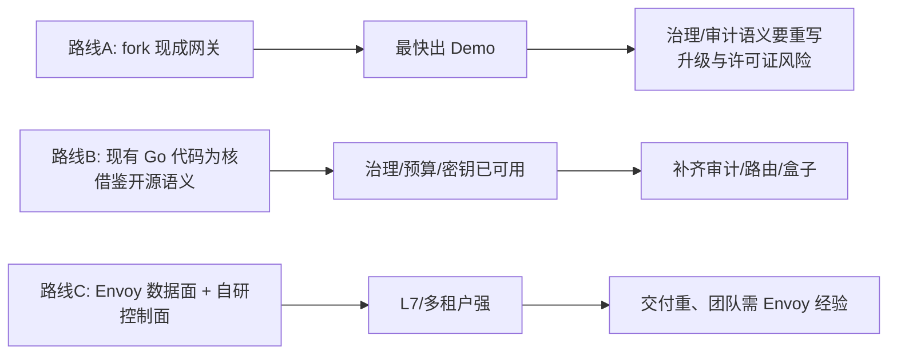
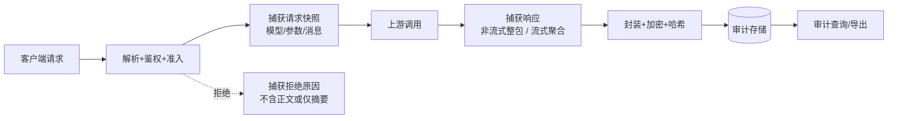
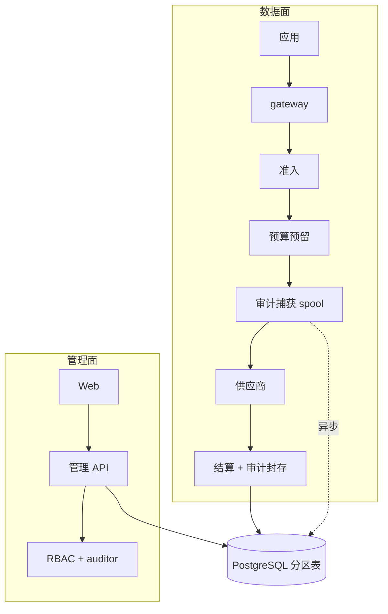

# 深层技术可行性评估：Token 治理 + 内容审计 + 软硬一体

| 项目 | 内容 |
| --- | --- |
| 评估对象 | 以开源大模型 API 中转软件为基础，做 Token 治理、内容审计、准入护城河，并交付 ARM/x86 硬件盒子 |
| 评估基线 | 代码基线 `9b8cf9d`（Go + PostgreSQL 模块化单体，已具备预算/准入/熔断/密钥/管理审计/人工对账）；文档 HEAD `0c51cce` |
| 评估性质 | 工程可行性论证，不是排期承诺；所有容量数字都是待验证假设，已标注验证方式 |
| 读者 | 产品经理、研发负责人、架构评审、硬件与运维负责人 |
| 结论口径 | 绿=可做且路径清晰；黄=可做但有必须先解决的约束；红=当前条件下不建议做或会破坏既有正确性 |

---

## 0. 结论摘要

### 0.1 一句话结论

**"Token 治理 + 内容审计 + 准入"在技术上可行，且当前 Go 代码已经完成治理主链路；真正的难点不在网关转发，而在三件事：内容审计的存储/加密/合规成本、2.0 路由对账本语义的改造、以及低端盒子上 PostgreSQL 与审计写入的 I/O 预算。** 以 Python 网关（如 LiteLLM）为底座做硬件盒子，是当前资源条件下风险最高的选项。

### 0.2 需求可行性评级

| PM 需求 | 评级 | 核心判断 | 主要约束 |
| --- | --- | --- | --- |
| 基于开源网关做二次开发 | 黄 | 可用开源做"能力参照 + 协议适配参考"，但不建议整仓 fork 作为产品底座 | 语言运行时、许可证、治理语义不匹配、升级成本 |
| Token 治理与计费 | 绿 | 现有实现已覆盖预留/结算/幂等/对账，1.0 只差预算周期与运营闭环 | 保守预留导致的额度占用、价格发布、跨周期 |
| Token 路由（1.0 固定别名） | 绿 | 现有"别名 → 固定供应商"已可用 | 无回退是刻意设计，销售话术不能说成"智能路由" |
| 智能路由 / 多供应商回退（2.0） | 黄 | 可行，但属于账本与执行模型的架构级改造 | 预留口径、attempt 计费、SSE 首字节后不可回退 |
| 内容审计（保存输入/输出） | 黄 | 技术路径清晰；合规与成本是决定项，不是技术障碍 | 加密、权限、留存、法务告知、低端盒子 I/O |
| 准入护城河 | 绿 | 已有密钥/RBAC/模型白名单/限流；差异化要靠 SSO、审批流与访问审计 | 需要工作流与成员管理，不只是限流参数 |
| 护栏（可选） | 黄 | 只做插件挂点，不自研模型；1.0 不做 | 外接服务的内容出境、延迟、误杀与责任 |
| ARM 低端盒子 | 黄 | 可跑，但必须限并发、限审计体积、用 SSD、默认单机 | PostgreSQL 内存/IOPS、eMMC 寿命、离线身份 |
| x86 中高端盒子 | 绿 | 与当前部署形态一致，主要是打包与运维产品化 | OTA、回滚、授权、监控 |
| 2.0 功能扩展 | 黄 | 当前代码的模块边界支持扩展，但插件化尚未设计 | 需要插件 SDK 与策略引擎，不能靠改代码堆功能 |

### 0.3 给产品经理的三句话

1. **1.0 不要碰"智能路由"**。它是账本语义改造，不是开关；做了会让"预算不超额"这个最强卖点变得难以证明。
2. **内容审计要当成一个独立产品面来做**：它带来存储、加密、检索、权限、法务五套成本，不能当作"多存两个字段"。
3. **盒子的低端型号决定架构**：如果低端只给 4GB 内存和 eMMC，就必须限制并发与审计保留，否则现场一定会出 I/O 与 OOM 问题。

---

## 1. 需求解读：把 PM 语言翻译成工程命题

### 1.1 产品定位拆解

| PM 表述 | 工程命题 | 是否已有 |
| --- | --- | --- |
| 开源 API 中转软件为基础 | 选底座：fork / 嵌入 / 借鉴 | 已有自研 Go 网关 |
| 完善 token 路由 | 别名路由（1.0）与策略路由（2.0） | 1.0 有，2.0 无 |
| 计费等 token 管控 | 预算硬上限、结算、对账 | 基本有 |
| 审计：保存输入输出 | 内容审计（payload audit） | **无，且当前设计明确不存正文** |
| 准入做护城河 | 身份、密钥、模型授权、准入决策可审计 | 部分有 |
| 护栏弱化 | 只留扩展点 | 无 |
| 扩展能力要强 | 插件/策略/协议适配的可演进性 | 接口清晰但无插件机制 |
| 硬件盒子，ARM + x86，低端到高端 | 单机交付、离线、OTA、容量分级 | 无任何交付件 |

### 1.2 必须先澄清的三个歧义

1. **"token 路由"**：是指按 token 预算/租户把请求分到不同上游，还是指 API Key 到项目的路由？两者架构完全不同。本文按"模型别名 → 供应商路由，2.0 增加策略路由"理解。
2. **"审计"**：当前系统里的"审计"是**管理审计**（谁改了权限/预算），PM 要的是**内容审计**（输入输出正文）。两者表结构、权限、留存、合规要求都不同，产品上必须分开命名，否则销售与客户会对不上。
3. **"c86"**：按 x86_64 理解。若指国产化指令集（如 LoongArch/申威），Go 支持情况与 PostgreSQL 打包要单独评估，不能与 x86 混为一谈。

### 1.3 与当前产品的冲突点（必须由 PM 决策）

当前代码与文档明确"默认不存提示词与回复正文，只存治理元数据"，这是隐私卖点。内容审计要求正好相反。可行做法是**按组织/项目开关 + 明确告知 + 分权访问**，但这是一次产品立场调整，必须写进合同与隐私政策，不能靠改配置偷偷打开。

---

## 2. 现状基线：已经有什么，缺什么

### 2.1 已有能力（可直接复用）

- 统一入口 `/v1/chat/completions`，文本 JSON/SSE，严格请求校验与上限（64 KiB 请求、64 条消息、16 MiB 流）。
- 项目密钥（SHA-256 摘要、一次性展示、实时撤销）、模型白名单、组织/项目 RBAC。
- 预算预留 → 派发 → 结算状态机，`request_id` 幂等，PostgreSQL 事务与账户锁，不确定状态保留占额。
- 准入：60 秒滑动窗口 + 并发租约，fail-closed；熔断：共享路由、单探测、generation 隔离。
- 执行元数据 `inference_attempts`（派发前写入、终态不可覆盖），与财务解耦。
- 管理审计（actor/action/resource）、标准账单 CSV 双人审核对账。
- 无正文存储、无插件机制、无本地账号体系、无部署镜像。

### 2.2 关键差距

| 差距 | 影响 | 工作量级 |
| --- | --- | --- |
| 无内容审计存储与权限 | 1.0 核心卖点缺失 | 大 |
| 无本地身份（仅 OIDC） | 离线盒子无法登录 | 中 |
| 无预算调整/周期轮转 | 客户每月要人工改库 | 中 |
| 无插件/策略机制 | 2.0 每加功能都改核心 | 中 |
| 无部署件/OTA/授权 | 盒子无法交付 | 大 |
| 无指标导出与告警 | 现场故障不可观测 | 中 |
| 无多 attempt 语义 | 2.0 路由回退无从下手 | 大（架构级） |

---

## 3. 开源基座选型：fork、嵌入还是借鉴

### 3.1 评估维度（按本项目权重排序）

1. **运行时与硬件适配**：ARM64 低端内存/启动时间/交叉编译难度。
2. **治理语义可塑性**：预算原子性、attempt 语义、审计挂点是否允许"先预留再派发"。
3. **扩展模型**：插件是进程内编译期、动态加载、WASM 还是 sidecar。
4. **许可证与商标**：能否闭源分发、能否改品牌、企业版边界。
5. **可运维性**：单二进制、依赖数量、升级与回滚。
6. **供应商覆盖**：协议差异是否已被别人踩过坑。

### 3.2 候选对比（结论基于公开资料与本仓库已完成的部分源码核验）

| 候选 | 语言/形态 | 优势 | 风险 | 作为底座适合度 |
| --- | --- | --- | --- | --- |
| LiteLLM | Python / FastAPI | 供应商覆盖最广；预算预留语义成熟；社区大 | Python 运行时与内存不适合低端盒子；GIL 下高并发需多进程；企业功能分层；治理语义需大改才能做硬上限 | 低（作为语义参照/测试对照高） |
| Bifrost | Go / 单二进制 | 插件生命周期、claim/abandon 取消模型成熟；性能形态好 | 能力面过宽；许可证与子目录需复核；本仓库研究时依赖下载受阻，未完整验证 | 中（借鉴生命周期） |
| Higress / Envoy AI Gateway | Go/C++ / Envoy 数据面 | L7 能力、可观测性、多租户成熟；ARM 有构建 | 引入 Envoy 控制面复杂度；治理逻辑要写插件；盒子交付变重 | 中（2.0 高流量时再评估） |
| APISIX / Kong AI Gateway | Lua(C)/Go 插件 | 生态成熟、插件多 | Lua 运行时与团队技术栈不匹配；企业版边界 | 低 |
| One API / New API 类 | Go | 中文生态、开箱计费/额度、部署简单 | 审计与预算原子性弱；多为"额度表"而非硬预留；扩展靠改核心 | 低（做功能对标） |
| Portkey Gateway | TypeScript | 路由与护栏生态活跃 | Node 运行时；核心能力在托管产品 | 低 |

> 许可证说明：本仓库仅对 Bifrost（Apache-2.0 根许可）与 LiteLLM（根 MIT + enterprise 单独授权）做过初查；其余候选的许可证、商标与子目录条款必须逐一复核后再决定分发方式。本文不把"开源"等同于"可闭源商用"。

### 3.3 三种路线与推荐



**推荐路线 B**，理由是可验证的：

1. 本项目最强卖点（预算硬上限、幂等结算、fail-closed 准入）已经在 Go 代码里，并且有 PostgreSQL 约束级保证；换底座等于把这些重写一遍。
2. 内容审计需要与 `request_id`、attempt、预算状态同事务或可对账地关联，只有控制面自己掌握这些 ID 才做得干净。
3. 盒子要求单二进制、低内存、ARM 交叉编译；Go 是最省事的选项，Python 需要额外打包与多进程调优。
4. 开源项目的价值主要在**供应商协议差异、SSE 边界、usage 缺失处理**这些"坑"，可以直接以 LiteLLM/Bifrost 的实现为对照测试用例，而不是把它们的运行时搬进来。

**唯一建议"嵌入"的外部件**：离线场景的身份提供方（如 Dex，Go 实现，可内嵌）与对象存储（MinIO，可选），其余保持自研或标准库。

### 3.4 如果 PM 坚持"必须有开源基座"

给一个可交付的折中：**对外叙事用"基于 OpenAI 兼容生态与开源网关实践"，代码上保持自主内核；把 LiteLLM 列为兼容性测试对象**（同请求分别打 LiteLLM 与本网关，比对响应结构、usage 处理、SSE 终止行为）。这样既不撒谎，也不把产品命门交给上游。

---

## 4. 核心能力可行性

### 4.1 Token 治理与计费

**结论：绿。** 现有实现已经跨过最难的部分（原子预留、幂等、结算边界、对账）。

1.0 需要补的产品能力：

| 能力 | 必要性 | 技术要点 |
| --- | --- | --- |
| 预算调整 API + 审计 | 高 | 只允许 owner/admin，写前锁账户，记录前后值 |
| 周期轮转 | 高 | 定时任务生成新 period 账户；旧周期只读；禁止改历史账本 |
| 按密钥/成员限额 | 中 | 新维度需要额外账户层级，注意"多层级预留"会放大锁竞争 |
| 超额策略 | 高 | 硬拒绝（现有）与"告警但放行"二选一，不能同一项目混用 |
| 价格发布 | 高 | 目录入库 + 版本 + 生效时间；否则每次调价都要重启 |

**必须接受的取舍**：当前按"输入上界 + max_tokens"预留，短请求会占用远高于实际成本的额度。上线前要么提高额度安全系数，要么实现"分段预留"（复杂），1.0 建议前者。

### 4.2 路由

**1.0（固定别名路由）：绿。** 已实现，语义清晰：一个别名对应一个供应商路由，失败不自动换。

**2.0（策略路由/回退）：黄，属于架构级改造。** 需要先解决四个问题：

1. **预留口径**：多候选供应商价格不同。按最贵候选预留会放大占额；按当前候选预留再切换，会出现"切换后超出已预留"的破口。
2. **attempt 计费**：现在 `inference_attempts.request_id` 唯一。多 attempt 需要 `(request_id, attempt_no)` 唯一，结算归属要明确"只结算成功的那次"还是"每次失败也计费"（部分供应商失败也计费）。
3. **SSE 语义**：首字节已下发后不可回退，否则客户端会看到拼接内容。可回退窗口只存在于"连接建立前"和"首字节前"。
4. **幂等**：客户端重试与网关内部回退必须区分，否则会把一次用户请求记成多次消费。

推荐 2.0 设计：**路由决策在预留之前**，按候选集的最坏成本预留；失败回退作为"新 attempt、同一 request_id、独立计费记录"，在首字节前允许，首字节后禁止；账本增加 attempt 级明细，但预算仍以 request 为聚合单位。

### 4.3 内容审计（本文重点）

#### 4.3.1 可行性判断

技术上完全可行：网关已经完整持有请求体与响应流，`request_id`、attempt、预算、密钥、模型都在手。真正的问题是**存什么、存多久、谁能看、怎么证明没被改、失败时是否阻断业务**。

#### 4.3.2 采集点与数据形态



- 请求快照：消息数组、模型别名、温度等参数、调用方身份（项目/密钥前缀）、来源 IP、时间。
- 响应快照：非流式取完整 JSON；流式需在转发同时聚合，必须有**字节上限**（建议 1 MiB，超出记录 `truncated=true` 与全文 SHA-256）。
- 失败请求：至少记录错误码与阶段；是否记录已产生的部分输出，由租户策略决定。
- **不要在 SSE 转发路径上做同步磁盘写**：会直接抬高首字节延迟并放大超时风险。

#### 4.3.3 存储方案对比

| 方案 | 优点 | 缺点 | 适用 |
| --- | --- | --- | --- |
| PostgreSQL 分区表（按月/组织） | 与现有事务同库、可按 request_id 关联、备份统一 | 大字段 TOAST/WAL 放大；单库容量有限 | 1.0 与中低端盒子 |
| 本地对象存储（MinIO/S3） | 容量便宜、易分层 | 多一个组件；一致性/权限另做 | 中高端盒子、2.0 |
| 仅本地文件 + 索引入库 | 写入快 | 备份/迁移/加密/权限都要自建 | 不建议 |
| 外部日志平台（ES/Loki） | 检索强 | 合规边界、成本、运维复杂度 | 2.0 可选导出 |

**1.0 推荐**：PostgreSQL 分区表 + 信封加密，单条内容 ≤ 256 KiB，超出截断并记录哈希；按月分区，保留策略按组织配置。**2.0 再引入对象存储**，用同一套 `payload_ref` 抽象切换。

#### 4.3.4 建议数据模型（示意，非最终 DDL）

```sql
-- 内容主体：与 request_id 一对一；分区键 created_at
CREATE TABLE audit_payloads (
  request_id   text NOT NULL,
  organization_id text NOT NULL,
  project_id   text NOT NULL,
  direction    text NOT NULL CHECK (direction IN ('request','response')),
  key_id       text,
  model        text,
  ciphertext   bytea NOT NULL,
  nonce        bytea NOT NULL,
  key_version  int  NOT NULL,
  sha256       bytea NOT NULL CHECK (octet_length(sha256)=32),
  plain_bytes  int NOT NULL CHECK (plain_bytes >= 0),
  truncated    boolean NOT NULL DEFAULT false,
  created_at   timestamptz NOT NULL DEFAULT clock_timestamp(),
  PRIMARY KEY (request_id, direction, created_at)
) PARTITION BY RANGE (created_at);

-- 每组织数据密钥（信封加密）
CREATE TABLE audit_deks (
  organization_id text NOT NULL,
  version int NOT NULL,
  wrapped_dek bytea NOT NULL,
  created_at timestamptz NOT NULL DEFAULT clock_timestamp(),
  retired_at timestamptz,
  PRIMARY KEY (organization_id, version)
);

-- 查看行为本身也要审计
CREATE TABLE audit_access_log (
  id bigint GENERATED ALWAYS AS IDENTITY PRIMARY KEY,
  organization_id text NOT NULL,
  actor_issuer text NOT NULL,
  actor_subject text NOT NULL,
  request_id text NOT NULL,
  reason text NOT NULL,
  created_at timestamptz NOT NULL DEFAULT clock_timestamp()
);
```

关键点：

- **加密**：AES-256-GCM，DEK 每组织一把，主密钥放 TPM/系统 keyring/KMS；`key_version` 支持轮换；数据库泄露不等于内容泄露。
- **防篡改**：每组织维护哈希链（`prev_hash` 或独立 chain 表），定期把链头写入不可变存储或打印归档；单条记录可校验，批量可验证连续性。仅靠"没人改数据库"不构成审计证据。
- **可检索性**：1.0 只按元数据（组织/项目/request_id/时间/模型）检索；全文检索需要解密，属于高风险能力，2.0 再评估（且必须独立授权）。
- **删除**：按分区 DROP 是最干净的方式；单条删除要同时清理索引、缓存、备份策略说明。**备份里仍有数据**这件事必须写进对客承诺。

#### 4.3.5 写入语义与故障策略（最容易被忽略的坑）

| 策略 | 行为 | 风险 | 建议 |
| --- | --- | --- | --- |
| 同步写审计后再返回 | 审计完整 | 延迟上升；审计库故障直接阻断业务 | 仅高合规租户可选 |
| 异步队列 + 本地落盘缓冲 | 延迟低、可耐受短时故障 | 需要 spool 上限、重放幂等、磁盘满策略 | **默认** |
| 只写元数据，正文异步补 | 最轻 | 崩溃窗口会缺正文，审计不完整 | 不满足"完整审计"诉求 |

推荐：**本地 WAL 式 spool（有界）+ 异步批量入库 + spool 满则 fail-closed（按租户策略）**。判定标准写成可测试的契约：审计入库成功率 100%、崩溃恢复后不缺记录、重复不重复计。

#### 4.3.6 权限与合规

- 新增 `auditor` 角色：只能读被授权项目的内容审计，不能改预算/密钥；查看必须填理由，并写入 `audit_access_log`。
- 双人复核：导出、批量查看、跨项目查看需要第二人批准（可复用现有双人审核模式）。
- 法务前置：员工告知/同意、用途限定、留存期限、删除请求、跨境限制、第三方个人数据（客户 prompt 里常含他人信息）。
- 数据出境：如果护栏用境外 API，等于把内容发出去；与"大陆驻留"卖点直接冲突，1.0 明确不做外接护栏。

#### 4.3.7 容量与成本模型（含公式）

设平均每请求审计字节 `B`（请求+响应，含 JSON 开销），峰值 `R` 请求/秒：

```
日增字节 ≈ B × R × 86400 × 峰值占空比
写放大   ≈ 3×（WAL + 索引 + TOAST）
```

示例（假设，需实测）：

- `B=8 KiB`、`R=10`、占空比 0.3：8 KiB × 10 × 86400 × 0.3 ≈ **2.1 GB/天**净增，乘 3 倍写放大 ≈ 6.4 GB/天。中低端可承受，但仍需 SSD。
- `B=16 KiB`、`R=50`、占空比 0.3：≈ **21 GB/天**净增，写放大 ≈ 64 GB/天。eMMC 与单盘 PG 都会吃紧，必须 NVMe 并做保留策略。
- `B=4 KiB`、`R=2`、占空比 0.5：≈ **0.35 GB/天**，低端盒子可长期运行，适合"小团队 + 30 天保留"的入门配置。

> 上面刻意保留计算过程，是为了让评审能替换参数，而不是接受一个拍脑袋的"能存 10 亿条"。

### 4.4 准入护城河

**结论：绿，但护城河不在"限流"。** 限流是商品化能力，真正难被替代的是：

1. **身份与组织映射**：企业 IdP/SCIM、组织-项目-成员三级权限、离职自动失效。
2. **申请与审批流**：谁能用哪个模型、额度多少、多久到期，全程留痕。
3. **准入决策可解释**：每次拒绝都能回答"哪条策略、哪个额度、哪个角色"。
4. **密钥治理**：轮换、到期、最小权限、创建者离开后的归属。

技术上都在现有 RBAC 与审计模型上扩展，不需要新中间件；难点是产品流程设计，不是代码。

### 4.5 护栏（Guardrails）

**结论：黄，1.0 不做，只留挂点。**

- 可行形态：请求前/响应后两个 hook，接口固定，超时可配置，失败策略可选（放行/拒绝）。
- 不自研分类模型：标注、误杀、对抗、模型更新都不是小团队能长期维护的。
- 外接护栏的代价：内容出境（合规）、额外延迟（100–500ms 量级）、按次计费、供应商可用性叠加。
- 若 2.0 要做，优先"规则型"（关键词、正则、长度、PII 正则）与"客户自带服务"，把模型型护栏留给集成商。

---

## 5. 硬件盒子可行性

### 5.1 架构与运行时约束

| 约束 | 现状 | 结论 |
| --- | --- | --- |
| 语言运行时 | Go 单二进制 | ARM64 交叉编译直接支持，适合盒子 |
| 数据库 | PostgreSQL 17 | ARM64 有官方包；低端需调参（shared_buffers、fsync、连接数） |
| Web 控制台 | 静态文件，同源托管 | 无 Node 运行时依赖，适合只读根文件系统 |
| 身份 | 仅 OIDC | **离线盒子必须先补本地管理员**，否则无法初始化 |
| 迁移 | 独立 `migrate` 二进制 | 可在升级脚本中先迁移再切版本 |
| 观测 | 进程内计数 | 盒子需要本地可导出的指标与日志轮转 |

### 5.2 容量分级（假设，必须用目标机型实测替换）

| 档位 | 参考硬件 | 目标并发 | 审计策略 | 风险 |
| --- | --- | --- | --- | --- |
| 低端 | ARM64 8 核 / 4–8 GB / 128–256 GB SSD | 8–16 并发，约 5 rps（按 2 s 上游延迟折算） | 单条 ≤64 KiB，保留 30 天，按月分区 | eMMC 寿命、PG 内存不足、OOM |
| 中端 | ARM64 16 核 / 16–32 GB / 512 GB NVMe | 32–64 并发，约 16 rps | 单条 ≤256 KiB，保留 90 天 | 备份窗口、审计写放大 |
| 高端 | x86 16–32 核 / 64 GB / 1–2 TB NVMe | 128 并发，约 50 rps | 全量 + 对象存储分层 | 单机仍非 HA；需明确不支持双机热备 |

**低端红线**：不要用 eMMC 做审计主存储。若审计写入达到每天 20 GB（约 50 rps、16 KiB/条，已属中端量级），一年就是 7 TB 以上，叠加 WAL 放大，消费级 eMMC 的 TBW 会很快耗尽，现场表现为"越用越慢直到写坏"。低端至少要用工业级 SSD，中高端用 NVMe，或把审计落到外置存储。

### 5.3 交付形态

- **1.0 单机**：systemd 管理三个进程（gateway/migrate 定时/可选 minio），只读根文件系统 + 独立数据分区，配置放 `/etc/aigw`，升级用 A/B 分区或容器镜像 + 回滚。
- **2.0 高可用**：数据库外置或主备；盒子只跑无状态网关；明确"单盒不承诺 HA"。
- **离线**：本地管理员 + 离线许可证（Ed25519 签名、绑定硬件指纹、宽限期），不走电话-home；时间同步必须本地 NTP，否则 JWT 与 OIDC 全部失效。
- **安全启动/固件签名**：属于硬件伙伴能力，需在选型时锁定，不能等软件做完再补。

### 5.4 盒子带来的产品约束（要写进销售材料）

1. 单盒不是高可用；数据库损坏的恢复时间以小时计。
2. 低端型号的并发与审计保留必须限死，超卖会导致现场不可用。
3. 离线环境没有企业 IdP 时，本地账号就是最高权限，必须强制首次改密与审计。
4. 审计内容加密后，**忘记主密钥等于数据永久丢失**，需要恢复密钥托管流程。

---

## 6. 目标架构演进

### 6.1 1.0（治理 + 审计 + 单机交付）



1.0 范围建议（按投入产出排序）：

1. 内容审计 MVP：请求/响应捕获、信封加密、分区、按 request_id 查询、auditor 角色、查看留痕、保留策略。
2. 本地管理员 + 可选 OIDC（离线可用）。
3. 预算调整 API + 周期轮转。
4. 部署件：镜像/安装包、迁移 Job、健康探针、日志轮转、基础指标导出。
5. 明确不做：智能路由、护栏模型、全文检索、多活。

### 6.2 2.0（路由 + 插件 + 规模化）

- 路由策略服务：候选集、权重、健康门槛、成本上限；决策在预留前。
- 多 attempt 账本：`(request_id, attempt_no)`、按 attempt 计费、请求级聚合。
- 插件 SDK：编译期注册 + 进程内 hook（鉴权后、派发前、响应后），禁止动态加载任意代码。
- 策略引擎：把人肉判断变成可版本化规则（CEL/OPA 二选一，先 CEL 更轻）。
- 审计分层：热数据 PG、冷数据对象存储、可选外部 SIEM 导出。

### 6.3 关键 ADR（建议补齐）

ADR 0011 已用于[模型发现与成员管理](adr/0011-model-discovery-and-membership-ui.md)，以下为后续建议编号；ADR 与数据库迁移独立编号，内容审计使用数据库迁移 0011，供应商管理已使用 0012、页面凭证使用 0013，预算/规则使用 0014、本地身份使用 0015，下一份从 0016 起。

| 编号 | 主题 | 必须回答 |
| --- | --- | --- |
| [0012](adr/0012-encrypted-content-audit.md) | 内容审计存储与加密（同步 MVP 已实现） | 加密、分权、保留；spool/KMS/外部锚定仍待完成 |
| [0013](adr/0013-managed-real-provider-configuration.md) | 真实供应商数据库管理（已实现） | 全局权限、原子发布、运行时路由 |
| [0023](adr/0023-scoped-member-offboarding.md) | 成员停用与恢复（验收见交付跟踪） | 凭据回收、作用域、竞态、显式恢复 |
| [0027](adr/0027-department-project-authorization.md) | 部门层级与项目授权（验收见交付跟踪） | 有界配置、继承、停用联动、独立密钥语义 |
| [0028](adr/0028-admission-department-cost-snapshots.md) | 入账时部门成本（验收见交付跟踪） | 历史快照、状态区分、当前鉴权、金额精度 |
| [0029](adr/0029-two-person-budget-adjustments.md) | 双人预算调额（验收见交付跟踪） | 防绕过、当前角色、余额复核、原子决定 |
| 0026（建议） | 开源基座与兼容策略 | 借鉴边界、许可证、升级路径 |
| [0014](adr/0014-encrypted-provider-credentials.md) | 页面供应商凭证（已实现） | 写入授权、加密、轮换、恢复 |
| [0017](adr/0017-offline-local-identity.md) | 正式离线身份（已实现） | 初始化、密码、会话、恢复 |
| [0022](adr/0022-two-party-organization-ownership.md) | 两方所有权交接（验收见交付跟踪） | 身份确认、原子角色切换、唯一约束与审计 |
| 0025（建议） | 盒子交付与离线授权 | 分区、OTA、回滚、许可证绑定 |
| [0015](adr/0015-budget-operations-and-periods.md) | 预算运营（已实现） | 调额、周期、旧账归属 |
| [0016](adr/0016-project-keyword-governance.md) | 项目关键字（已实现） | 确定性规则、流式边界、无正文事件 |
| [0018](adr/0018-protected-prometheus-metrics.md) | 受保护 Prometheus（已实现） | 境内抓取、固定标签、无原文 |
| [0019](adr/0019-ledger-cost-reports.md) | 账本成本报表（实现/验收见交付跟踪） | 状态分列、精度、权限与导出审计 |
| [0020](adr/0020-transactional-budget-notifications.md) | 预算站内告警（实现/验收见交付跟踪） | 原子写入、去重、确认与审计 |
| [0021](adr/0021-durable-content-audit-checkpoints.md) | 审计持久检查点（验收见交付跟踪） | 转发前提交、租约、恢复、容量边界 |
| 0024（建议） | 多 attempt 与路由 | 预留口径、计费归属、首字节边界 |

### 6.4 实现状态核对（2026-11-04，内容审计增量）

模型发现与 Web 成员管理已实现（ADR 0011）。本次在同步远端基线 dfa87f9 后实现[内容审计同步 MVP](content-audit.md)（ADR 0012、数据库 0011）：项目默认关闭/显式开启、AES-GCM 信封加密、请求预写与 JSON/SSE 完成前封存、独立项目审计员、理由及访问留痕、有界截断/完整已观测 SHA、组织哈希链验证、到期拒读与分批清理、Web 与 CLI 元数据。

验证证据：125 个后端顶层测试及 9 个浏览器场景通过；真实临时 PostgreSQL、签名测试 IdP、合成 TLS 供应商。未使用真实供应商凭证，不代表生产或大陆物理驻留验收。

本章之前的“无内容审计”描述保留为评估历史，当前状态以本节和操作手册为准。第 7 节接口仍是估算草案，实际项目作用域契约见 OpenAPI；本阶段没有组织级解密 GET 或导出接口。

尚未实现：异步持久 spool/崩溃回复零丢失、月分区自动维护、KMS SDK、自动外部不可变锚定、双人导出、生产容量及清理/备份演练。当前默认分区与按行清理不等于月分区运维闭环；DB 内链不能防御超级用户整体重写。审计员为独立项目能力，未新增全局组织角色。

本地管理员/离线身份、预算调整/周期轮转、部署件/OTA/许可证、Prometheus/OTel 仍未完成。2.0 多 attempt/路由回退/插件/guardrail 仍待开发。原 33–49 人周为完整目标的历史估算，不能凭本轮测试折算剩余工期；M-B 部分实现，10.2 生产门禁仍未全部达成。下一步先完成生产审计恢复/容量验收，再推进本地管理员与预算调整。

---

## 7. 接口与数据增量（供研发估算）

### 7.1 管理 API 增量

| 方法 | 路径 | 说明 |
| --- | --- | --- |
| GET | `/api/v1/organizations/{org}/audit/content?request_id=` | 解密返回单条内容，写访问日志 |
| GET | `/api/v1/organizations/{org}/projects/{project}/audit/content` | 按时间/模型分页，仅元数据 |
| POST | `/api/v1/organizations/{org}/audit/exports` | 申请导出，需第二人批准 |
| PUT | `/api/v1/organizations/{org}/audit/policy` | 保留期、是否存正文、截断阈值 |
| PUT | `/api/v1/organizations/{org}/projects/{project}/budget` | 预算调整（带 revision） |

### 7.2 对现有表的改动

- `inference_attempts`：2.0 才需要 `attempt_no` 与失败计费字段；1.0 不动。
- `budget_reservations`：1.0 不动；2.0 增加父请求聚合视图，不改变现有主键语义。
- 新增：`audit_payloads`、`audit_deks`、`audit_access_log`、`audit_chain`（或等价列）。
- 迁移编号从 0011 起；已发布 SQL 不改。

---

## 8. 性能与容量：可验证的工程目标

### 8.1 当前开销来源（每请求）

鉴权查询 → 准入事务（清理+计数+租约）→ 熔断事务 → 预留事务（两账户锁）→ attempt 写入 → dispatch 更新 → 结算事务 → attempt 终态。约 8–10 次数据库往返，全部在关键路径上。

### 8.2 1.0 性能目标（建议写进验收）

| 指标 | 目标 | 测法 |
| --- | --- | --- |
| 审计附加 p99 延迟 | ≤ 5 ms（异步 spool 入盘） | 固定硬件、模拟上游、对比开关前后 |
| 审计完整性 | 100%（含崩溃恢复） | 注入 kill -9、断库、磁盘满 |
| 低端机型吞吐 | ≥ 5 rps 持续 30 分钟无错误（按多项目合计；默认 60 rpm/项目需先放大限流） | 目标 ARM 盒子实测 |
| 内存 | 峰值 ≤ 60% 物理内存 | 含 PG |
| 备份恢复 | RTO ≤ 2 h、RPO ≤ 15 min（盒子） | 实际演练 |

> 这些是**验收目标**，不是承诺值；必须先测再对外报价。

### 8.3 压测必须覆盖的故障

1. 审计库写入变慢（模拟 fsync 抖动）时，网关是否仍能保持首字节时间。
2. spool 磁盘写满：是否按策略拒绝新请求，且拒绝原因可解释。
3. 上游 SSE 半途断开：审计记录是否标记 `incomplete`，预算是否进入 uncertain。
4. 并发审核与并发结算：是否出现重复结算（现有唯一索引是否覆盖新路径）。

---

## 9. 合规与安全（内容审计的前置条件）

| 议题 | 风险 | 建议措施 |
| --- | --- | --- |
| 员工/终端用户告知 | 未告知即存正文，可能违反个人信息保护要求 | 合同 + 登录页告知 + 组织级开关 |
| 数据最小化 | 全文长期保存超出必要 | 分级保留：元数据 180 天、正文 30/90 天可选 |
| 访问控制 | 管理员可随意查看内容 | auditor 独立角色 + 双人审批 + 查看留痕 |
| 加密与密钥 | 数据库泄露导致内容泄露 | 信封加密 + TPM/KMS + 轮换 |
| 删除权 | 备份中仍有数据 | 明确备份保留窗口与销毁证明 |
| 跨境 | 护栏/模型调用出境 | 1.0 只允许境内端点，护栏不做境外调用 |
| 审计证据效力 | 可被数据库管理员篡改 | 哈希链 + 链头外锚 + 只追加权限 |

---

## 10. 工作量与里程碑（估算，需团队校准）

| 工作流 | 内容 | 估算（人周） |
| --- | --- | --- |
| 内容审计核心 | 捕获、spool、加密、分区、查询、auditor 角色、访问日志 | 10–14 |
| 审计前端 | 列表/详情/导出申请/策略配置/无障碍 | 4–6 |
| 本地身份与离线 | 本地管理员、密码策略、可选内嵌 IdP | 4–6 |
| 预算运营 | 调整 API、周期轮转、审计 | 3–5 |
| 部署与盒子 | 镜像/安装包、A/B 升级、许可证、日志与指标 | 8–12 |
| 性能与可靠性 | 压测、故障注入、备份恢复演练 | 4–6 |
| 合计（1.0 增量） | 不含现有治理能力 | **33–49** |

2.0 增量（路由 + 插件 + 审计分层）另计 25–40 人周。以上不含硬件选型、认证、法务与真实供应商联调。

### 10.1 建议里程碑

1. **M-A（2–3 周）**：审计存储 PoC + 低端盒子压测，回答"能不能跑"。
2. **M-B（4–6 周）**：审计闭环 + 本地登录 + 预算调整，内网试用。
3. **M-C（3–4 周）**：盒子交付件 + 备份恢复 + 安全验收，小范围商用。
4. **M-D（后续）**：路由与插件，按真实客户需求排。

### 10.2 Go / No-Go 门禁

- 法务书面确认内容审计的告知、留存、访问与删除方案。
- 低端目标机型实测：10 rps 持续 30 分钟、p99 附加延迟 ≤5 ms、审计零丢失。
- 断电/断库/磁盘满三类故障演练通过。
- 单条内容加密与密钥轮换演练通过，丢失主密钥的恢复流程有文档。
- 真实供应商 + 真实账单对账完成一次闭环。

任一项不通过，不对外承诺"可审计"。

---

## 11. 风险登记（技术视角）

| 风险 | 概率 | 影响 | 缓解 |
| --- | --- | --- | --- |
| 低端盒子 I/O 成为瓶颈 | 高 | 高 | NVMe 起步、限制审计体积、分区 + 保留、实测后再定价 |
| 审计被当成"全量日志"卖，成本失控 | 高 | 高 | 分级保留、截断 + 哈希、按组织配额 |
| 2.0 路由破坏预算正确性 | 中 | 高 | 决策前置、按最坏成本预留、attempt 级账本、灰度 |
| 合规未过关就上线 | 中 | 高 | 法务门禁、默认关闭正文存储 |
| fork 开源后被上游拖死 | 中 | 中 | 只借鉴语义、保持 OpenAPI 兼容、建立对照测试 |
| 离线部署无 IdP 无法登录 | 高 | 高 | 本地管理员 + 首次强制改密 |
| 插件机制引入安全漏洞 | 中 | 高 | 编译期注册、无动态代码、权限最小化 |
| 单盒被客户当 HA 用 | 高 | 高 | 合同与 UI 明示、健康检查、备份演练 |

---

## 12. 结论与建议（按优先级）

1. **底座**：以现有 Go 代码为核，LiteLLM 作为协议与预算语义的对照实现；不整仓 fork。若 2.0 需要 L7 多租户能力，再评估 Envoy AI Gateway/Higress。
2. **1.0 范围**：内容审计（加密 + 分区 + 分权 + 保留）+ 本地登录 + 预算调整/轮转 + 单机交付件。**不做**智能路由、护栏模型、全文检索。
3. **2.0 范围**：路由策略 + 多 attempt 账本 + 插件 SDK + 审计冷热分层。
4. **盒子**：ARM 低端先做 PoC，用目标机型实测再定容量与价格；eMMC 不可作为审计主存储；离线授权与本地身份必须先做。
5. **护城河**：把"准入"讲成"身份 + 审批 + 可解释拒绝 + 内容可审计"，而不是"我们有限流"。

### 12.1 需要 PM 本周拍板的 8 个问题

1. 内容审计默认开还是默认关？哪些行业必须开？
2. 正文保留多久？30/90/180 天三档是否够卖？
3. 谁有权看正文？是否需要客户侧"双人审批"？
4. 审计写入失败时，业务是否阻断？按租户配置还是全局？
5. 1.0 是否承诺离线部署？如果承诺，本地账号体系必须进范围。
6. 低端盒子的目标并发与价格带是多少？（决定硬件选型与审计上限）
7. 路由回退是否进入 2.0 承诺？如果进入，需要接受账本改造周期。
8. 护栏是"预留接口"还是"交付功能"？对外话术必须一致。

---

## 附录 A：开源项目核验清单（采用前逐项打勾）

- [ ] 许可证允许闭源分发与改名（含子目录、资产、商标）
- [ ] 目标架构有官方或可复现构建（ARM64）
- [ ] 无强制 telemetry/phone-home
- [ ] 依赖树可离线构建（盒子交付要求）
- [ ] 安全公告响应渠道明确
- [ ] 与现有 OpenAPI 兼容层的冲突点已列出
- [ ] 升级策略：跟随上游还是冻结快照
- [ ] 许可证与版权声明进入产品"关于"页

## 附录 B：术语

| 术语 | 含义 |
| --- | --- |
| 管理审计 | 谁改了权限/预算/密钥等治理动作 |
| 内容审计 | 保存模型输入输出正文，用于事后核查 |
| 信封加密 | 数据用 DEK 加密，DEK 再由主密钥/KMS 包裹 |
| spool | 本地有界落盘缓冲，用于审计异步入库 |
| attempt | 一次上游调用尝试；当前一请求最多一次 |
| 哈希链 | 每条记录含前一条哈希，用于证明未被篡改 |
| TBW | 固态盘总写入寿命指标 |

供应商管理增量：Web/API 已可发布真实路由、价格、驻留依据到 PostgreSQL，普通启动不再默认 mock。详见[真实供应商管理](provider-management.md)，真实付费和部署驻留仍需验收。

后续 P0/P1 实现状态以 [交付跟踪](p0-p1-delivery.md) 为准，包含预算运营、关键字匹配、正式本地身份、监控与成本报表；本节早期验收数字保留为当阶段证据，不代表最新全部功能。
